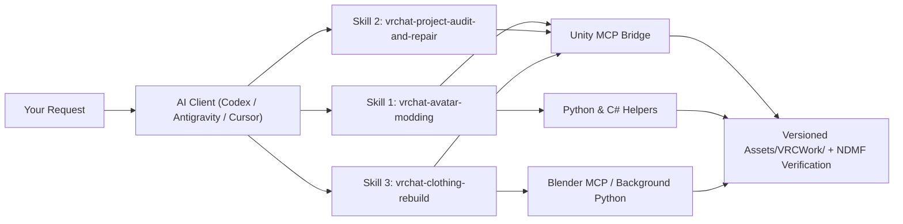

<div align="center">
  
  <h1>VRChat Avatar Modding Skills & MCP Toolkit</h1>
</div>

[](https://github.com/asmrawa/vrchat-avatar-modding-skills/actions/workflows/ci.yml)
[](LICENSE)
[](https://creators.vrchat.com/avatars/)

**English** | [简体中文](README_CN.md) | [日本語](README_JA.md)

An end-to-end **Agent Skills + Unity MCP + Blender MCP** toolkit that turns AI coding assistants (**Codex**, **Antigravity**, **Cursor**, and any Agent Skills / MCP client) into a structured, non-destructive VRChat avatar modding workflow.

Instead of letting an AI guess Unity YAML or overwrite vendor prefabs, this toolkit gives it **live Unity & Blender control**, **deterministic C#/Python helpers**, and **modular VRChat engineering playbooks**.

---

## What It Can Do

| Area | Capabilities |
| --- | --- |
| **Outfits, Hair & Multi-Outfit Wardrobes** | Attach adapted outfits and hairstyles via Modular Avatar / NDMF, wire mutually exclusive `Int` wardrobes, split shared skinned meshes (e.g., shoes & socks), relocate shared accessories across outfits with rest-pose-preserving bind-pose math, and fix AFK/action visibility issues. |
| **Expression Menus, Parameters & FX Toggles** | Build independent `Bool` toggles, `Int` selectors, linked rules (e.g., hiding ears when a hat is active and restoring them cleanly), hand-prop exclusions, label translations without breaking parameters, and enforce VRChat's 8-controls/page & 256-bit synced limits. |
| **Texture & PSD Editing (Photoshop + Pillow + GPT Image)** | Edit layered `.psd` files non-destructively (preserving author groups/masks for future manual editing), recolor UV islands via grayscale masks, add transparent decals/lettering, or repaint irises/hair streaks/embroidery with GPT Image and composite them back pixel-locked onto the original UV atlas. |
| **Props, Lighting, Fit & Optimization** | Align handheld props, Contacts, and constraints to real poses; unify material lighting and `probeAnchor` references across worlds; audit PhysBones, particle capacities, Mip Streaming, Write Defaults, and SDK build/upload errors. |
| **Blender Garment Rebuild** | Reconstruct torso-fitted clothing meshes in Blender for modified body shapes while preserving original UVs, materials, and skin weights, render 3-angle orthographic previews, and import back into Unity automatically. |
| **Read-Only Project Audit & Safe Repair** | Inspect any VRChat Unity project without modifying files—tracing scenes, prefabs, `{fileID, guid}` references, Animator curves, and post-NDMF build output—and perform minimal, scoped repairs only when explicitly requested. |

---

## How Each Workflow Works Under The Hood



### 1. Safe Non-Destructive Unity Automation
- **Live Editor Control**: The bundled **AnkleBreaker Unity MCP** bridges your AI client directly to the running Unity Editor (supporting multi-instance discovery and dynamic port selection). The AI inspects real `VRCAvatarDescriptor`, Modular Avatar components, renderers, materials, and Animator states instead of guessing from text files.
- **Strict Isolation**: Vendor assets (`Assets/<Vendor>/`) are never edited. Every modification creates a versioned work scene and asset folder under `Assets/VRCWork/` and saves only owned dirty assets (`AssetDatabase.SaveAssetIfDirty`), keeping prior versions intact for instant rollback.
- **3-Layer Verification**: Every check distinguishes between **(1) static YAML/GUID files**, **(2) Unity Editor resolved state**, and **(3) NDMF / Modular Avatar / AAO build-resolved output**. Animation/pose checks run on temporary clones so the work scene's rest skeleton is never altered.
- **Bundled C# Primitives**: Reusable helpers ([`VrcAvatarIntegration.cs`](skills/vrchat-avatar-modding/scripts/VrcAvatarIntegration.cs), [`VrcMaterialSwap.cs`](skills/vrchat-avatar-modding/scripts/VrcMaterialSwap.cs)) handle clip/controller cloning, float-allowlist lighting copies, rest-pose-invariant skin rebinding, and safe material swaps.

### 2. How Texture & PSD Editing Works (PSD-First Pipeline)
Choose the editable source using [the UV texture guide](skills/vrchat-avatar-modding/references/psd-texture-workflow.md).
1. **Locate the true texture in Unity**: Identify the exact renderer, submesh, material slot, shader properties (`_MainTex`, `_EmissionMap`, overlays), and any FX animation curves swapping materials on that slot.
2. **Layered deliverable**. Prefer a versioned copy of a registered PSD. Compare its composite with the approved atlas and preserve existing line art, groups and masks.
3. **Choose the operation**. For a direct PNG change, start with the approved atlas. Use Pillow for exact color or glyph edits and GPT Image for new artwork. Either can supply artwork for a PSD layer.
   - **Color / palette shift**: [`vrc_texture_tool.py`](skills/vrchat-avatar-modding/scripts/vrc_texture_tool.py) `recolor` maps source luminance to a new shadow/midtone/highlight ramp inside a grayscale mask.
   - **Transparent decals & lettering**: `vrc_texture_tool.py composite --decal` blends a source-sized RGBA layer through the island mask without creating opaque backing boxes.
   - **New painted art (irises, hair highlights, embroidery)**: [`vrc_gpt_texture_edit.py`](skills/vrchat-avatar-modding/scripts/vrc_gpt_texture_edit.py) (or a host image tool / prompt-only ChatGPT workflow) edits the original atlas using dual masks (an API guidance mask + a pixel-exact delivery mask). The result can be placed onto a new masked PSD layer or composited onto the PNG after `clean-bg` gutter cleanup.
4. **Automated Pixel & Unity Verification**: `vrc_texture_tool.py compare` verifies exact dimensions, `outside_mask=0`, `alpha_changed=0`, visible RGB change, and PNG ICC/sRGB metadata before binding via `VrcMaterialSwap.cs` and testing on the avatar's attached `Animator` in Unity.

### 3. How Blender Clothing Rebuild Works
For outfits that no longer match a modified torso silhouette ([`vrchat-clothing-rebuild`](skills/vrchat-clothing-rebuild/SKILL.md)):
1. [`fit_clothing.py`](skills/vrchat-clothing-rebuild/scripts/fit_clothing.py) runs in Blender background mode, projects the garment's main shell onto the evaluated target body mesh via ray casting with smoothstep collar/sleeve/waist falloff, transfers displacement to attached ornaments via KD-tree weighting, and renders 3 orthographic previews (front, side, quarter) while preserving vertex order, UVs, materials, and vertex groups.
2. After you inspect and approve the previews, [`install_unity.py`](skills/vrchat-clothing-rebuild/scripts/install_unity.py) backs up the work scene and stages a verified one-shot Unity C# importer that maps vertex deltas onto the original Unity FBX mesh, clones its UVs, bone weights, and bind poses into a new work mesh asset, assigns it, and reports completion.
3. Optional headless Blender MCP support is included via [`blender_mcp_headless.py`](skills/vrchat-clothing-rebuild/scripts/blender_mcp_headless.py).

### 4. Account & Upload Safety
- SDK builds, previews, and online uploads are strictly separated and only run on explicit request.
- VRChat SDK login, passwords, 2FA, CAPTCHA, and ownership agreements are **always handled manually by you** in Unity's visible SDK Control Panel—credentials are never stored, logged, or typed by scripts.

---

## Prerequisites: What You Need

| Component | Status | Why It Is Needed |
| --- | --- | --- |
| **AI Client** (Codex / Antigravity / Cursor / compatible client) | Required | Loads the 3 Agent Skills and connects to MCP servers. |
| **Unity Editor + VRChat SDK3 (Avatars)** | For Unity work | Your VRChat project (exact Unity version in `ProjectSettings/ProjectVersion.txt`). Modular Avatar, NDMF, lilToon/Poiyomi, Gesture Manager, and Avatar Optimizer are recommended. |
| **Node.js >= 18** | Required for Unity MCP | Runs the bundled `unity-mcp/unity-mcp-server` Node bridge (verified on Node.js 24). |
| **Python >= 3.10** | Required for CLI tools | Runs offline Blueprint/budget/log audits, texture tools, clothing scripts, and `doctor.py`. |
| **Pillow (`pip install pillow`)** | For the Pillow CLI | Required by `vrc_texture_tool.py` (`recolor`, `composite`, `clean-bg`, `compare`). |
| **Photoshop / PSD editor (or `psd-tools`)** | Optional (PSD editing) | Recommended for interactive layered `.psd` editing and exporting. |
| **OpenAI-compatible Images API Key** | Optional (Mode A AI art) | Only needed for direct API calls via `vrc_gpt_texture_edit.py`; Mode B (host image tool) and Mode C (prompt-only) need no API key. |
| **Blender + `uv` (`uvx`)** | Optional (Mesh/clothing) | Blender runs the fitter directly. uvx is needed for the bundled MCP server. |

Check everything installed on your machine in one command:

```powershell
python -X utf8 scripts/doctor.py
```

---

## Included Skills & Repository Layout

| Skill | When To Use | Entry File |
| --- | --- | --- |
| **`vrchat-avatar-modding`** | Main modding: outfits, wardrobes, menus/FX, props, PSD/AI textures, lighting/fit, optimization, SDK build triage | [`skills/vrchat-avatar-modding/SKILL.md`](skills/vrchat-avatar-modding/SKILL.md) |
| **`vrchat-project-audit-and-repair`** | Read-only project inspection (static YAML/GUID, live Unity MCP, `-batchmode`, NDMF build) + explicit-only safe repair & cleanup | [`skills/vrchat-project-audit-and-repair/SKILL.md`](skills/vrchat-project-audit-and-repair/SKILL.md) |
| **`vrchat-clothing-rebuild`** | Blender torso-fit mesh reconstruction, 3-angle previews, and verified Unity re-import preserving weights & UVs | [`skills/vrchat-clothing-rebuild/SKILL.md`](skills/vrchat-clothing-rebuild/SKILL.md) |

```text
vrchat-avatar-modding-skills/
├── skills/
│   ├── vrchat-avatar-modding/            # Main workflow + 10 references + 7 C#/Python scripts
│   ├── vrchat-project-audit-and-repair/  # 3-layer audit + symptom triage + safe repair
│   └── vrchat-clothing-rebuild/          # Blender rebuild pipeline + Unity importer + headless MCP
├── unity-mcp/                            # Bundled AnkleBreaker Unity MCP plugin (2.32.0) & server (2.30.0)
├── blender-mcp/                          # Bundled MCP for Blender (2.3.1 wheel + add-on)
├── assets/                               # Project emblem / icon
├── config/                               # MCP config examples (Codex TOML, generic JSON)
├── templates/                            # Sanitized multi-session handoff template
├── scripts/                              # doctor.py, validate_toolkit.py, package_skills.py
├── tests/                                # 20 automated unit tests
├── install.ps1 / install.sh              # One-click installers (Windows / macOS / Linux)
└── THIRD_PARTY_NOTICES.md                # Full upstream attributions & licenses
```

> All `SKILL.md` and `references/` files are written in concise English to save tokens and maximize cross-client accuracy; you can still chat and give instructions in Chinese, Japanese, English, or any language.

---

## Quick Start

Clone the repository (or download the all-in-one Skills bundle `vrchat-avatar-modding-skills.zip` from [GitHub Releases](https://github.com/asmrawa/vrchat-avatar-modding-skills/releases)) into a fixed folder such as `C:/Tools/vrchat-avatar-modding-skills`. Run commands below from the repo root.

### Step 1: Install the Skills

**Windows (PowerShell):**
```powershell
# Choose: codex | antigravity | cursor | all
.\install.ps1 -Client codex

# Optional: also install Unity MCP Node dependencies and the Blender add-on
.\install.ps1 -Client all -InstallUnityMcpDeps -InstallBlenderAddon
```

**macOS / Linux:**
```bash
chmod +x install.sh
./install.sh codex   # or: antigravity | cursor | all
```

### Step 2: Connect Unity MCP

1. Open your VRChat Unity project with its matching Unity version.
2. Go to `Window -> Package Manager -> + -> Add package from disk...` and select [`unity-mcp/unity-mcp-plugin/package.json`](unity-mcp/unity-mcp-plugin/package.json).
3. After compilation, open `Window -> AB Unity MCP` and confirm `Server Running` (default port range `7890-7899`).
4. Install locked Node.js server dependencies:
   ```powershell
   $toolkit = (Get-Location).Path
   $unityDir = Join-Path $toolkit 'unity-mcp/unity-mcp-server'
   $nodeExe = (Get-Command node.exe -ErrorAction Stop).Source
   $unityEntry = Join-Path $unityDir 'src/index.js'
   Push-Location -LiteralPath $unityDir
   try { npm.cmd ci --omit=dev --ignore-scripts } finally { Pop-Location }
   ```
5. Register the server in your client:
   - **Codex CLI**: `codex mcp add unity_mcp -- "$nodeExe" "$unityEntry"` (or merge [`config/codex.config.example.toml`](config/codex.config.example.toml))
   - **Antigravity / Cursor / JSON MCP clients**: Merge the `unity-mcp` block from [`config/antigravity_mcp.example.json`](config/antigravity_mcp.example.json) with your local paths.
6. Restart your client and verify with `unity_list_instances`.

### Step 3: Connect Blender MCP (Optional)

1. Install **Blender** and **[uv](https://docs.astral.sh/uv/getting-started/installation/)**.
2. Install the bundled Blender add-on:
   ```powershell
   $toolkit = (Get-Location).Path
   $uvxExe = (Get-Command uvx.exe -ErrorAction Stop).Source
   $wheel = Join-Path $toolkit 'blender-mcp/mcp_for_blender-2.3.1-py3-none-any.whl'
   & $uvxExe --from $wheel mcp-for-blender install-addon
   ```
   *(Or install [`blender-mcp/mcp_for_blender_addon.py`](blender-mcp/mcp_for_blender_addon.py) via Blender `Preferences -> Add-ons -> Install from Disk`.)*
3. Enable `MCP for Blender` in Blender Preferences, press `N` in the 3D Viewport, and click `Start MCP Server` (or launch headless with [`blender_mcp_headless.py`](skills/vrchat-clothing-rebuild/scripts/blender_mcp_headless.py)).
4. Register in your client:
   - **Codex CLI**: `codex mcp add blender --env BLENDER_MCP_SAFE_MODE=1 --env DISABLE_TELEMETRY=true -- "$uvxExe" --from "$wheel" mcp-for-blender`
   - **Antigravity / Cursor / JSON MCP clients**: Merge the `blender` block from [`config/antigravity_mcp.example.json`](config/antigravity_mcp.example.json).

---

## Example Prompts

**1. First-time read-only project inspection:**
> Use `vrchat-project-audit-and-repair`. List Unity instances, verify the active project, scene, and avatar root, then inspect Expression Menus, synced parameter cost, and FX controllers. Read-only this turn—do not modify or save anything.

**2. Add a new outfit with wardrobe toggles:**
> Use `vrchat-avatar-modding`. Save a new versioned work scene under `Assets/VRCWork/`, integrate the imported outfit prefab with Modular Avatar while keeping original toggles working, check NDMF baked bones and the 256-bit parameter budget, and summarize what was verified.

**3. Edit an avatar texture:**
> Locate the visible material and its current atlas. Keep a layered source for future editing when requested. For this PNG edit, preserve protected pixels and alpha, and show a close-up of the result on the work material.

**4. Rebuild torso-fitted clothing in Blender:**
> Use `vrchat-clothing-rebuild`. Inspect the target body and garment islands in Blender, configure a torso-fit rebuild with 3-angle orthographic previews, and wait for my review before importing into Unity.

> **Long multi-session projects?** Copy [`templates/AVATAR_HANDOFF_TEMPLATE.md`](templates/AVATAR_HANDOFF_TEMPLATE.md) into your private workspace to track scene versions, wardrobe parameters, and rollback points across sessions.

---

## Development & Verification

```bash
python -X utf8 scripts/doctor.py
python -X utf8 scripts/validate_toolkit.py
python -X utf8 -m unittest discover -s tests -v
python -X utf8 scripts/package_skills.py
```

---

## Licenses & Attribution

- Original skills, scripts, templates, and documentation: **MIT License** ([`LICENSE`](LICENSE)).
- `skills/vrchat-avatar-modding/`: Derived from [felixchaos/vrchat-avatar-modding-skill](https://github.com/felixchaos/vrchat-avatar-modding-skill) (**MIT License**).
- `blender-mcp/`: Bundled from [mcp-for-blender 2.3.1](https://pypi.org/project/mcp-for-blender/2.3.1/) by Siddharth Ahuja (**MIT License**).
- `unity-mcp/`: **Powered by AnkleBreaker MCP** ([unity-mcp-plugin](https://github.com/AnkleBreaker-Studio/unity-mcp-plugin) `2.32.0` · [unity-mcp-server](https://github.com/AnkleBreaker-Studio/unity-mcp-server) `2.30.0`), licensed under **AnkleBreaker Open License v1.0** (free distribution permitted; commercial resale prohibited). See [`THIRD_PARTY_NOTICES.md`](THIRD_PARTY_NOTICES.md) for complete notices.


> **Note**: Always use legally obtained avatar bases, outfits, shaders, and VRChat SDK packages. Never commit commercial assets, Blueprint IDs, or account credentials.
