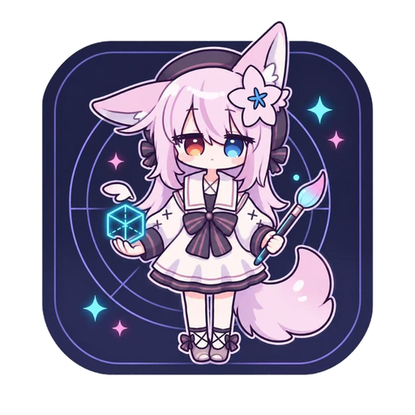
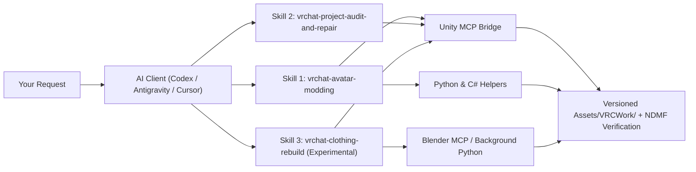

<div align="center">
  
  <h1>VRChat Avatar Modding Skills & MCP Toolkit</h1>
</div>

[](https://github.com/asmrawa/vrchat-avatar-modding-skills/actions/workflows/ci.yml)
[](LICENSE)
[](https://creators.vrchat.com/avatars/)

**English** | [简体中文](README_CN.md) | [日本語](README_JA.md)

This toolkit provides three Agent Skills and C#/Python helpers for non-destructive VRChat avatar modding. Optional Unity and Blender MCP integrations are installed separately from their upstream projects.

---

## What It Can Do

| Area | Capabilities |
| --- | --- |
| **Outfits, Hair & Multi-Outfit Wardrobes** | Attach adapted outfits and hairstyles via Modular Avatar / NDMF, wire mutually exclusive `Int` wardrobes, split shared skinned meshes (e.g., shoes & socks), relocate shared accessories across outfits with rest-pose-preserving bind-pose math, and fix AFK/action visibility issues. |
| **Expression Menus, Parameters & FX Toggles** | Build independent `Bool` toggles, `Int` selectors, linked rules (e.g., hiding ears when a hat is active and restoring them cleanly), hand-prop exclusions, label translations without breaking parameters, and enforce VRChat's 8-controls/page & 256-bit synced limits. |
| **Texture & PSD Editing (Photoshop + Pillow + GPT Image)** | Edit layered `.psd` files non-destructively (preserving author groups/masks for future manual editing), recolor UV islands via grayscale masks, add transparent decals/lettering, or repaint irises/hair streaks/embroidery with GPT Image and composite them back pixel-locked onto the original UV atlas. |
| **Props, Lighting, Fit & Optimization** | Align handheld props, Contacts, and constraints to real poses; unify material lighting and `probeAnchor` references across worlds; audit PhysBones, particle capacities, Mip Streaming, Write Defaults, and SDK build/upload errors. |
| **Blender Inspection & Garment Rebuild (Experimental)** | Connect Blender MCP for mesh inspection, geometry analysis, and assisted vertex edits. Includes an experimental ray-cast torso-fitting pipeline (`vrchat-clothing-rebuild`, opt-in only) that preserves UVs and skinning, subject to manual collision/pose review. |
| **Read-Only Project Audit & Safe Repair** | Inspect any VRChat Unity project without modifying files—tracing scenes, prefabs, `{fileID, guid}` references, Animator curves, and post-NDMF build output—and perform minimal, scoped repairs only when explicitly requested. |

---

## How Each Workflow Works Under The Hood



### 1. Safe Non-Destructive Unity Automation
- **Live Editor Control**: **AnkleBreaker Unity MCP** bridges your AI client directly to the running Unity Editor (supporting multi-instance discovery and dynamic port selection). The AI inspects real `VRCAvatarDescriptor`, Modular Avatar components, renderers, materials, and Animator states instead of guessing from text files.
- **Strict Isolation**: Vendor assets (`Assets/<Vendor>/`) are never edited. Every modification creates a versioned work scene and asset folder under `Assets/VRCWork/` and saves only owned dirty assets (`AssetDatabase.SaveAssetIfDirty`), keeping prior versions intact for instant rollback.
- **3-Layer Verification**: Every check distinguishes between **(1) static YAML/GUID files**, **(2) Unity Editor resolved state**, and **(3) NDMF / Modular Avatar / AAO build-resolved output**. Animation/pose checks run on temporary clones so the work scene's rest skeleton is never altered.
- **Bundled C# Primitives**: Reusable helpers ([`VrcAvatarIntegration.cs`](skills/vrchat-avatar-modding/scripts/VrcAvatarIntegration.cs), [`VrcMaterialSwap.cs`](skills/vrchat-avatar-modding/scripts/VrcMaterialSwap.cs)) handle clip/controller cloning, float-allowlist lighting copies, rest-pose-invariant skin rebinding, and safe material swaps.

### 2. How Texture & PSD Editing Works (PSD-First Pipeline)
Choose the editable source using [the UV texture guide](skills/vrchat-avatar-modding/references/psd-texture-workflow.md).
1. **Locate the true texture in Unity**: Identify the exact renderer, submesh, material slot, shader properties (`_MainTex`, `_EmissionMap`, overlays), and any FX animation curves swapping materials on that slot.
2. **Use the matching PSD first**. Compare its composite with the atlas used in Unity. Edit a versioned copy and preserve existing line art, groups, and masks, even for PNG-only delivery.
3. **Choose the operation**. Use the approved PNG if layered editing is unavailable or the user requests a direct PNG edit. Pillow can make precise color or glyph edits, and GPT Image can supply new artwork. Either can supply artwork for a PSD layer.
   - **Color / palette shift**: [`vrc_texture_tool.py`](skills/vrchat-avatar-modding/scripts/vrc_texture_tool.py) `recolor` maps source luminance to a new shadow/midtone/highlight ramp inside a grayscale mask.
   - **Transparent decals & lettering**: `vrc_texture_tool.py composite --decal` blends a source-sized RGBA layer through the island mask without creating opaque backing boxes.
   - **New painted art (irises, hair highlights, embroidery)**: [`vrc_gpt_texture_edit.py`](skills/vrchat-avatar-modding/scripts/vrc_gpt_texture_edit.py) (or a host image tool / prompt-only ChatGPT workflow) edits the original atlas using dual masks (an API guidance mask + a pixel-exact delivery mask). The result can be placed onto a new masked PSD layer or composited onto the PNG after `clean-bg` gutter cleanup.
4. **File, Unity, and visual checks**. Use `vrc_texture_tool.py compare` to verify dimensions, protected pixels, alpha, and color metadata. Test relevant states on the avatar's Animator and read back the saved references. Compare renders under matching conditions and mark visual review as pending if the images cannot be inspected.

### 3. Blender MCP & Clothing Rebuild (Experimental)
This toolkit separates **Blender MCP** (a general bridge for mesh inspection, geometry analysis, and assisted vertex edits) from the experimental **automated garment rebuild** workflow ([`vrchat-clothing-rebuild`](skills/vrchat-clothing-rebuild/SKILL.md)):

- **What works today**:
  1. **Blender MCP**: Lets AI assistants inspect Blender objects, check mesh islands/weights, and assist with targeted edits (including headless mode via [`blender_mcp_headless.py`](skills/vrchat-clothing-rebuild/scripts/blender_mcp_headless.py)).
  2. **Experimental torso-fit pipeline**: [`fit_clothing.py`](skills/vrchat-clothing-rebuild/scripts/fit_clothing.py) projects the main garment shell onto the target body via ray casting, transfers deltas via KD-tree weighting, renders 3 orthographic previews, and [`install_unity.py`](skills/vrchat-clothing-rebuild/scripts/install_unity.py) stages a Unity importer that clones UVs, weights, and bind poses into a new mesh asset.
- **Current limitations**:
  - **No full collision solver**: Ray casting alone cannot guarantee zero intersection with the body.
  - **Dynamic clipping risk**: Passing static rest-pose checks does not guarantee zero clipping during raised arms, crouching, sitting, or high-leg motions.
  - **Narrow scope**: Targets torso garments in a specific local coordinate convention (`X` across, `Y` up, `+Z` forward); the Unity importer currently targets single-submesh (`subMeshCount == 1`) garments.
  - **No automatic repair**: Rebuilt meshes still require manual visual and anatomical inspection.
  - **Technical import != visual acceptance**: Clean UVs, skin weights, and Unity persistence do not guarantee production-ready aesthetics.
- **Usage recommendation**: Keep Blender MCP as an optional inspection/assisted-editing tool. For production avatar modding, prefer **Unity MCP + Modular Avatar + NDMF + vendor-adapted outfits**. Use `vrchat-clothing-rebuild` **only** when you explicitly request an experimental rebuild, have backed up your project, and plan to inspect the result manually.

### 4. Account & Upload Safety
- SDK builds, previews, and online uploads are strictly separated and only run on explicit request.
- VRChat SDK login, passwords, 2FA, CAPTCHA, and ownership agreements are **always handled manually by you** in Unity's visible SDK Control Panel—credentials are never stored, logged, or typed by scripts.

---

## Prerequisites: What You Need

| Component | Status | Why It Is Needed |
| --- | --- | --- |
| **AI Client** (Codex / Antigravity / Cursor / compatible client) | Required | Loads the 3 Agent Skills and connects to MCP servers. |
| **Unity Editor + VRChat SDK3 (Avatars)** | For Unity work | Your VRChat project (exact Unity version in `ProjectSettings/ProjectVersion.txt`). Modular Avatar, NDMF, lilToon/Poiyomi, Gesture Manager, and Avatar Optimizer are recommended. |
| **Node.js >= 18** | For AnkleBreaker Unity MCP | Runs the separately installed Node server. |
| **Python >= 3.10** | Required for CLI tools | Runs offline Blueprint/budget/log audits, texture tools, clothing scripts, and `doctor.py`. |
| **Pillow (`pip install pillow`)** | For the Pillow CLI | Required by `vrc_texture_tool.py` (`recolor`, `composite`, `clean-bg`, `compare`). |
| **Photoshop / PSD editor (or `psd-tools`)** | Optional (PSD editing) | Recommended for interactive layered `.psd` editing and exporting. |
| **OpenAI-compatible Images API Key** | Optional (Mode A AI art) | Only needed for direct API calls via `vrc_gpt_texture_edit.py`; Mode B (host image tool) and Mode C (prompt-only) need no API key. |
| **Blender + `uv` (`uvx`)** | Optional (inspection / experimental rebuild) | Blender runs the fitting scripts. `uvx` starts the separately installed Blender MCP. |

Check everything installed on your machine in one command:

```powershell
python -X utf8 scripts/doctor.py
```

---

## Included Skills & Repository Layout

| Skill | When To Use | Entry File |
| --- | --- | --- |
| **`vrchat-avatar-modding`** | Main modding: outfits, wardrobes, menus/FX, props, PSD/AI textures, lighting/fit, optimization, SDK build triage | [`skills/vrchat-avatar-modding/SKILL.md`](skills/vrchat-avatar-modding/SKILL.md) |
| **`vrchat-project-audit-and-repair`** | Read-only project inspection (static YAML/GUID, live Unity MCP, `-batchmode`, NDMF build) + explicit-only safe repair & cleanup | [`skills/vrchat-project-audit-and-repair/SKILL.md`](skills/vrchat-project-audit-and-repair/SKILL.md) |
| **`vrchat-clothing-rebuild`** | *(Experimental / Opt-in only)* Blender torso-fit mesh reconstruction, 3-angle previews, and Unity re-import—not recommended for default production workflows | [`skills/vrchat-clothing-rebuild/SKILL.md`](skills/vrchat-clothing-rebuild/SKILL.md) |

```text
vrchat-avatar-modding-skills/
├── skills/
│   ├── vrchat-avatar-modding/            # Main workflow + 10 references + 7 C#/Python scripts
│   ├── vrchat-project-audit-and-repair/  # 3-layer audit + symptom triage + safe repair
│   └── vrchat-clothing-rebuild/          # Experimental Blender rebuild pipeline + Unity importer + headless MCP
├── assets/                               # Project emblem / icon
├── config/                               # MCP config examples (Codex TOML, generic JSON)
├── templates/                            # Sanitized multi-session handoff template
├── scripts/                              # doctor.py, validate_toolkit.py, package_skills.py
├── tests/                                # 20 automated unit tests
├── install.ps1 / install.sh              # One-click installers (Windows / macOS / Linux)
└── THIRD_PARTY_NOTICES.md                # Full upstream attributions & licenses
```

> All `SKILL.md` and `references/` files are written in concise English to save tokens and maximize cross-client accuracy; you can still chat and give instructions in Chinese, Japanese, English, or any language.

---

## Quick Start

Clone the repository (or download the all-in-one Skills bundle `vrchat-avatar-modding-skills.zip` from [GitHub Releases](https://github.com/asmrawa/vrchat-avatar-modding-skills/releases)) into a fixed folder such as `C:/Tools/vrchat-avatar-modding-skills`. Run commands below from the repo root.

### Step 1: Install the Skills

**Windows (PowerShell):**
```powershell
# Choose: codex | antigravity | cursor | all
.\install.ps1 -Client codex
```

**macOS / Linux:**
```bash
chmod +x install.sh
./install.sh codex   # or: antigravity | cursor | all
```

### Step 2: Connect Unity MCP

Reuse your existing Unity MCP connection if it already works. If an older setup points into this toolkit checkout, move to an upstream installation and update the project and client references before upgrading.

1. In the VRChat project, follow the [upstream Unity plugin install guide](https://github.com/AnkleBreaker-Studio/unity-mcp-plugin#installation). Then follow the [companion Node server guide](https://github.com/AnkleBreaker-Studio/unity-mcp-server#get-started) and keep its checkout outside this toolkit.
2. Register the installed server in your client using the [`unity_mcp` TOML example](config/codex.config.example.toml) or the [`unity-mcp` JSON example](config/antigravity_mcp.example.json). Use the absolute path to the external server's `src/index.js`.
3. Restart or reconnect the MCP client and call `unity_list_instances` to verify the target project.

### Step 3: Connect Blender MCP (Optional)

1. Install **Blender** and **[uv](https://docs.astral.sh/uv/getting-started/installation/)**.
2. Install the Blender add-on from the [upstream PyPI package](https://pypi.org/project/mcp-for-blender/2.3.1/):
   ```sh
   uvx mcp-for-blender==2.3.1 install-addon
   ```
3. Enable `MCP for Blender` in Blender Preferences, press `N` in the 3D Viewport, and click `Start MCP Server` (or launch headless with [`blender_mcp_headless.py`](skills/vrchat-clothing-rebuild/scripts/blender_mcp_headless.py)).
4. Register in your client:
   - **Codex CLI**: `codex mcp add blender --env BLENDER_MCP_SAFE_MODE=1 --env DISABLE_TELEMETRY=true -- uvx mcp-for-blender==2.3.1`
   - **Antigravity / Cursor / JSON MCP clients**: Merge the `blender` block from [`config/antigravity_mcp.example.json`](config/antigravity_mcp.example.json).

---

## Example Prompts

**1. First-time read-only project inspection:**
> Use `vrchat-project-audit-and-repair`. List Unity instances, verify the active project, scene, and avatar root, then inspect Expression Menus, synced parameter cost, and FX controllers. Read-only this turn—do not modify or save anything.

**2. Add a new outfit with wardrobe toggles:**
> Use `vrchat-avatar-modding`. Save a new versioned work scene under `Assets/VRCWork/`, integrate the imported outfit prefab with Modular Avatar while keeping original toggles working, check NDMF baked bones and the 256-bit parameter budget, and summarize what was verified.

**3. Edit an avatar texture:**
> Locate the visible material and its current atlas. For this direct PNG edit, preserve protected pixels and alpha, and show a close-up of the result on the work material.

**4. Experimental Blender garment test (opt-in, backup required):**
> I have backed up my project and want to run an experimental `vrchat-clothing-rebuild` test. Inspect the target body and garment islands in Blender, generate 3-angle orthographic previews first, and wait for my manual review before importing anything into a Unity test scene.

> **Long multi-session projects?** Copy [`templates/AVATAR_HANDOFF_TEMPLATE.md`](templates/AVATAR_HANDOFF_TEMPLATE.md) into your private workspace to track scene versions, wardrobe parameters, and rollback points across sessions.

---

## Development & Verification

```bash
python -X utf8 scripts/doctor.py
python -X utf8 scripts/validate_toolkit.py
python -X utf8 -m unittest discover -s tests -v
python -X utf8 scripts/package_skills.py
```

---

## Licenses & Attribution

| Component | License | Distribution |
| --- | --- | --- |
| Original toolkit files | [MIT](LICENSE) | Included |
| Core modding Skill adapted from [Felix's work](https://github.com/felixchaos/vrchat-avatar-modding-skill) | [MIT and upstream attribution](skills/vrchat-avatar-modding/LICENSE) | Included |
| Powered by AnkleBreaker MCP | [AnkleBreaker Open License v1.0](https://github.com/AnkleBreaker-Studio/unity-mcp-plugin/blob/main/LICENSE) | Optional upstream installation |
| [MCP for Blender](https://pypi.org/project/mcp-for-blender/2.3.1/) | MIT | Optional upstream installation |

See [THIRD_PARTY_NOTICES.md](THIRD_PARTY_NOTICES.md) for upstream credits and license links.

> **Note**: Always use legally obtained avatar bases, outfits, shaders, and VRChat SDK packages. Never commit commercial assets, Blueprint IDs, or account credentials.
