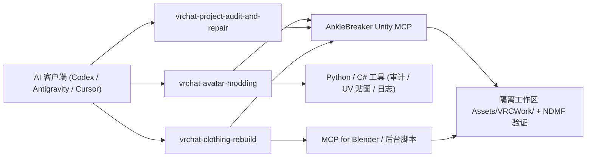

# VRChat 改模 Skills 与 Unity / Blender MCP 工具包

[](https://github.com/asmrawa/vrchat-avatar-modding-skills/actions/workflows/ci.yml)
[](LICENSE)
[](https://creators.vrchat.com/avatars/)

[English](README.md) | **简体中文** | [日本語](README_JA.md)

一套经过大量真实 VRChat 改模实战打磨的 **Agent Skills** + **Unity MCP** + **Blender MCP** 工具包，帮助 AI 安全、非破坏式地完成 Unity 换装、道具、表情开关、材质贴图、性能优化与 Blender 服装贴合重建。

原生适配 **Codex**、**Antigravity**、**Cursor** 等所有支持 Agent Skills 标准与 MCP 协议的客户端。

---

## 为什么做这套工具包？

普通 AI 直接改 VRChat 工程极易踩坑：直接改坏原作者预制体、误解析 Unity YAML、在工作场景采样动画污染休止骨架导致“衣服飞起”、触发 NDMF 构建重入导致“粉球事故”、或是超出 256-bit 同步表达参数上限。

本工具包将几十轮真实改模经验沉淀为 **3 个职责清晰、零重叠、客户端中立的 Skills**：

- **默认非破坏式工作流**：严禁篡改原厂 FBX/Prefab/Controller，所有改动隔离在独立版本工作场景（`Assets/VRCWork/`），通过 `AssetDatabase.SaveAssetIfDirty` 精准落盘、随时可回退。
- **三层核验体系**：严格区分 **静态序列化文件（YAML/GUID）**、**Unity 实时解析状态（MCP 或 `-batchmode`）** 与 **NDMF / Modular Avatar / AAO 构建后最终状态**。
- **高频故障内置避坑手册**：涵盖休止骨架污染（衣服悬空）、NDMF 构建重入（粉球事故）、替换发型 AFK 消失、`probeAnchor` 与受光下限偏差、AAO BlendShape 重映射、重复 PhysBone 审计、鞋袜共用网格拆分、UV 透明贴字防白块、256-bit 参数预算审计等。
- **账号安全红线**：VRChat SDK 登录、密码、二步验证（2FA）与人机校验一律交由用户在 Unity 可见界面手动完成，绝不记录或代输凭据。

---

## 工作流架构



## 包含的 3 个 Skills

| Skill | 定位 | 核心能力 |
| --- | --- | --- |
| [`vrchat-avatar-modding`](skills/vrchat-avatar-modding/SKILL.md) | **核心改模工作流** | 整套换装与多衣柜互斥、手持道具与 Contact、菜单与 FX 开关联动、AFK 替换发型修复、UV 改色与贴字、局部贴合与受光统一、身高警告与性能优化、SDK 构建排错、内置 7 个 C#/Python 实用脚本 |
| [`vrchat-project-audit-and-repair`](skills/vrchat-project-audit-and-repair/SKILL.md) | **只读项目审计与显式安全修复** | 三层检查（静态 GUID/fileID、Unity MCP 或两轮批处理检查、NDMF 构建态）、高频症状分流诊断、仅在明确授权后执行最小范围修复与无引用候选清理 |
| [`vrchat-clothing-rebuild`](skills/vrchat-clothing-rebuild/SKILL.md) | **Blender 贴身服装曲面重建** | Blender 后台射线投影重建躯干贴合、保留 UV/材质/顶点组、自动三视图正交预览渲染、验证后一键回灌 Unity 保蒙皮权重、附带 Blender 无头 MCP 启动器 |

> 注：所有 `SKILL.md` 与 `references/` 均采用精炼英文编写，兼顾最低 Token 消耗与跨语言/跨客户端通用性；你依然可以直接用简体中文向 AI 提问和下达改模指令。

---

## 目录结构

```text
vrchat-avatar-modding-skills/
├── skills/
│   ├── vrchat-avatar-modding/            # 核心改模主流程 + 10 篇专题参考 + 7 个 C#/Python 工具
│   ├── vrchat-project-audit-and-repair/  # 只读三层审计 + 症状分流 + 安全修复校验
│   └── vrchat-clothing-rebuild/          # Blender 贴合重建脚本 + Unity 一次性回灌器 + 无头 MCP 启动器
├── unity-mcp/                            # 随包提供的 AnkleBreaker Unity MCP 插件 (2.32.0) 与服务端 (2.30.0)
├── blender-mcp/                          # 随包提供的 MCP for Blender (2.3.1 wheel 与插件脚本)
├── config/                               # MCP 配置示例（Codex、Antigravity / Cursor）
├── templates/                            # 通用跨会话改模交接模板（已脱敏）
├── scripts/                              # 环境体检 doctor、全量 QA 校验与 Skill 打包脚本
├── tests/                                # Python 离线工具单元测试
├── install.ps1 / install.sh              # Windows / macOS / Linux 一键安装脚本
└── THIRD_PARTY_NOTICES.md                # 完整的第三方开源归属与许可声明
```

---

## 快速上手

先将本仓库克隆或解压到固定目录（例如 `C:/Tools/vrchat-avatar-modding-skills`），以下命令均在仓库根目录执行。

### 1. 安装改模 Skills

**Windows（PowerShell）：**

```powershell
# 安装到 Codex（也可选：antigravity、cursor、all）
.\install.ps1 -Client codex

# 可选：同时安装 Unity MCP Node 依赖与 Blender 插件
.\install.ps1 -Client all -InstallUnityMcpDeps -InstallBlenderAddon
```

**macOS / Linux：**

```bash
chmod +x install.sh
./install.sh codex   # 可选：antigravity | cursor | all
```

完成后重启客户端或新开会话即可生效。

**一键环境体检（随时排查缺失依赖）：**

```powershell
python -X utf8 scripts/doctor.py
```

**跨多轮对话改模交接**：将 [`templates/AVATAR_HANDOFF_TEMPLATE.md`](templates/AVATAR_HANDOFF_TEMPLATE.md) 复制到你的私人工作目录，记录工作场景版本、衣柜参数与回退点，后续新开会话直接交给 AI 接力。

---

### 2. 连接 Unity MCP

1. 使用工程 `ProjectSettings/ProjectVersion.txt` 指定的对应 Unity 版本打开你的 VRChat 工程。
2. 在 Unity 中打开 `Window → Package Manager → + → Add package from disk...`，选择 [`unity-mcp/unity-mcp-plugin/package.json`](unity-mcp/unity-mcp-plugin/package.json)。
3. 等待编译完成后打开 `Window → AB Unity MCP`，确认显示 `Server Running`（默认端口范围 `7890–7899`）。
4. 安装锁定版本的 Node.js 依赖（要求 Node.js 18+，已于 Node.js 24 验证）：

```powershell
$toolkit = (Get-Location).Path
$unityDir = Join-Path $toolkit 'unity-mcp/unity-mcp-server'
$nodeExe = (Get-Command node.exe -ErrorAction Stop).Source
$unityEntry = Join-Path $unityDir 'src/index.js'
Push-Location -LiteralPath $unityDir
try { npm.cmd ci --omit=dev --ignore-scripts } finally { Pop-Location }
```

5. 在你的 AI 客户端中注册 Unity MCP：
   - **Codex CLI**：`codex mcp add unity_mcp -- "$nodeExe" "$unityEntry"`（或合并 [`config/codex.config.example.toml`](config/codex.config.example.toml)）。
   - **Antigravity / Cursor / 通用 JSON 客户端**：将 [`config/antigravity_mcp.example.json`](config/antigravity_mcp.example.json) 中的 `unity-mcp` 段落合并到配置并替换本机路径。
6. 重启客户端，让 AI 调用 `unity_list_instances` 核对工程路径与活动场景，并通过 `unity_select_instance` 选中目标实例。

---

### 3. 连接 Blender MCP（可选，用于网格/服装贴合编辑）

1. 安装 **Blender** 与 **[uv](https://docs.astral.sh/uv/getting-started/installation/)**（要求 Python 3.10+）。
2. 从随包提供的 wheel 安装匹配的 Blender 插件：

```powershell
$toolkit = (Get-Location).Path
$uvxExe = (Get-Command uvx.exe -ErrorAction Stop).Source
$wheel = Join-Path $toolkit 'blender-mcp/mcp_for_blender-2.3.1-py3-none-any.whl'
& $uvxExe --from $wheel mcp-for-blender install-addon
```

   *（也可在 Blender 的 `编辑 → 偏好设置 → 插件 → Install from Disk` 中直接选择 [`blender-mcp/mcp_for_blender_addon.py`](blender-mcp/mcp_for_blender_addon.py)。）*
3. 在 Blender 插件中勾选启用 `MCP for Blender`，在 3D 视图按 `N` 打开侧栏点击 `Start MCP Server`（如需无界面后台运行，可使用 [`skills/vrchat-clothing-rebuild/scripts/blender_mcp_headless.py`](skills/vrchat-clothing-rebuild/scripts/blender_mcp_headless.py)）。
4. 在 AI 客户端中注册 Blender MCP：
   - **Codex CLI**：`codex mcp add blender --env BLENDER_MCP_SAFE_MODE=1 --env DISABLE_TELEMETRY=true -- "$uvxExe" --from "$wheel" mcp-for-blender`（或合并 [`config/codex.config.example.toml`](config/codex.config.example.toml)）。
   - **Antigravity / Cursor / 通用 JSON 客户端**：参考 [`config/antigravity_mcp.example.json`](config/antigravity_mcp.example.json) 合并 `blender` 段落。

---

## 画图与 UV 贴图统一工作流：有 PSD 优先改 PSD，无 PSD 再改 PNG

只要工程或原包里有与当前贴图 UV 对齐的 `.psd`，一律优先在版本化 PSD 副本上用图层和蒙版做局部修改（完整保留原作者分组、剪贴蒙版、混合模式、线稿与阴影**不合并压平**，方便后续随时用 Photoshop 继续微调）；需要 GPT Image 绘制新虹膜、挑染或刺绣时，把生成的局部候选对位贴回独立 PSD 图层并挂上蒙版后导出；仅在没有 PSD、只有扁平 PNG 图集时，直接用 `vrc_texture_tool.py`（`recolor` 色阶映射、`clean-bg` 去底噪、`composite` 遮罩回贴、`composite --decal` 透明徽章文字、`compare --require-visible-change --check-color-metadata` 像素与 ICC 色彩元数据校验），最后在 Unity 用角色挂载的 Animator 实测所有材质切换状态。详见统一手册：[PSD 优先与 AI 辅助 UV 贴图工作流](skills/vrchat-avatar-modding/references/psd-texture-workflow.md)。

## 首次使用指令示例

**只读体检（推荐首次使用先跑一次）：**

> 使用 `vrchat-project-audit-and-repair` 技能。先列出 Unity 实例，核对目标工程、活动场景和角色根对象，再检查现有 Expression Menu、同步参数占用和 FX Controller。本轮仅只读检查，不要修改或保存任何文件。

**整合新衣服与菜单开关：**

> 使用 `vrchat-avatar-modding` 技能。先在 `Assets/VRCWork/` 下另存独立版本工作场景，通过 Modular Avatar 整合新导入的服装预制体并保留原衣开关，核验 NDMF 合并后的骨骼绑定与 256-bit 参数预算，最后汇报实际验证到的环节。

**Blender 贴身服装重建：**

> 使用 `vrchat-clothing-rebuild` 技能。在 Blender 检查角色素体和目标服装的连通网格岛，配置躯干贴合重建并输出三视图预览，等我确认预览图无误后再写入 Unity 工作场景。

---

## 开发者自检

```bash
# 校验所有 Skill 元数据、Markdown 相对链接、脱敏隐私检查与 Python 语法
python scripts/validate_toolkit.py

# 运行 Python 离线审计与贴图工具单元测试
python -m unittest discover -s tests -v

# 在 dist/ 中生成三个独立的 Skill 压缩包
python -X utf8 scripts/package_skills.py
```

---

## 开源许可与第三方声明

- 本仓库原创 Skills、脚本、配置模板与文档采用 **MIT License**（见 [`LICENSE`](LICENSE)）。
- `skills/vrchat-avatar-modding/` 基于 [felixchaos/vrchat-avatar-modding-skill](https://github.com/felixchaos/vrchat-avatar-modding-skill)（**MIT License**）深度扩展。
- `blender-mcp/` 随包提供自 Siddharth Ahuja 的 [mcp-for-blender 2.3.1](https://pypi.org/project/mcp-for-blender/2.3.1/)（**MIT License**）。
- `unity-mcp/`：**Powered by AnkleBreaker MCP**（[unity-mcp-plugin](https://github.com/AnkleBreaker-Studio/unity-mcp-plugin) `2.32.0` · [unity-mcp-server](https://github.com/AnkleBreaker-Studio/unity-mcp-server) `2.30.0`），遵循 **AnkleBreaker Open License v1.0**（允许免费分发与集成，禁止商业转售）。完整声明见 [`THIRD_PARTY_NOTICES.md`](THIRD_PARTY_NOTICES.md)。


> **提示**：角色素体、服装、着色器及 VRChat SDK 请使用你本人合法获取的资产；分享或提交代码前请勿包含商业模型资产、Blueprint ID 或个人账号信息。
