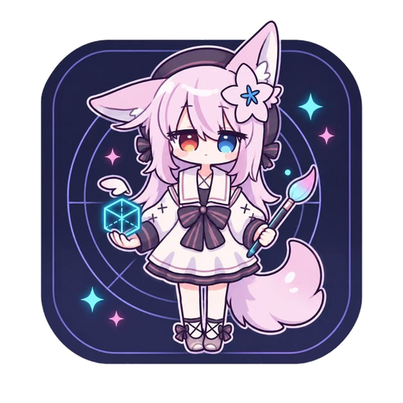
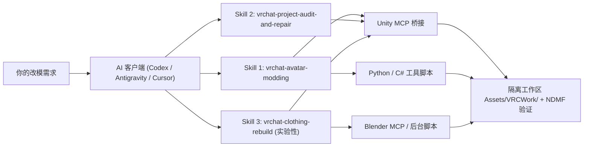

<div align="center">
  
  <h1>VRChat 改模 Skills 与 Unity / Blender MCP 工具包</h1>
</div>

[](https://github.com/asmrawa/vrchat-avatar-modding-skills/actions/workflows/ci.yml)
[](LICENSE)
[](https://creators.vrchat.com/avatars/)

[English](README.md) | **简体中文** | [日本語](README_JA.md)

为 Codex、Antigravity、Cursor 等客户端提供三套 VRChat 改模 Skills 和 C#／Python 辅助脚本，用于非破坏式换装、菜单开关、贴图编辑和工程审计。Unity 与 Blender MCP 按需从各自上游安装。

---

## 它能帮你做什么？

| 模块 | 具体能力 |
| --- | --- |
| **换装、发型与多套衣柜** | 通过 Modular Avatar / NDMF 非破坏式整合衣服与发型；制作多套服装互斥（`Int` 衣柜）；拆分共用蒙皮网格（如把鞋和袜套拆成独立开关）；将帽子/眼镜/发饰做成跨服装共享配件并自动重算蒙皮绑定矩阵；修复换发型后挂机（AFK）消失或错位问题。 |
| **表情菜单、参数与 FX 开关** | 制作独立开关（`Bool`）、多选互斥（`Int`）、条件联动（如戴帽自动收耳、换回其他套装自动恢复）、手持道具互斥、仅翻译菜单显示文案而不破坏参数名，并自动核验每页 8 项与 256-bit 同步参数上限。 |
| **画图与贴图编辑（PSD 优先 + Pillow + GPT Image）** | 匹配的 PSD 适合保留分层。直接改 PNG 时可用 Pillow 做局部换色、透明徽章贴字和边距清理；需要新画虹膜、挑染或刺绣时用 GPT Image 局部编辑，再按遮罩合回。 |
| **道具、受光、微调与性能优化** | 校准手持道具握点、Contact 与约束；统一不同服装材质的受光下限与 `probeAnchor` 探针锚点；审计重复 PhysBone、粒子峰值容量、Mip Streaming、Write Defaults 以及 SDK 本地构建/上传报错。 |
| **Blender 模型检查与服装重构（实验性）** | 保留 Blender MCP 用于模型检查、网格分析与局部辅助编辑；另附实验性躯干重构流程 `vrchat-clothing-rebuild`（仅限手动显式启用），可保留 UV 与蒙皮权重回灌 Unity，但需人工复核穿模与动态姿态。 |
| **只读项目审计与安全修复** | 默认只读不改文件，帮你查清场景、Prefab 覆盖、GUID/fileID 引用链、菜单/FX 动画绑定以及 NDMF 合并后的真实结果；只有在你明确要求时才在隔离工作区执行最小范围修复与无引用文件清理。 |

---

## 各项功能是怎么实现的？



### 1. Unity 改模是如何做到安全且可回退的？
- **实时操控 Unity（Unity MCP）**：接入 **AnkleBreaker Unity MCP** 后，AI 可以直接发现当前打开的 Unity 实例、读取场景层级、组件、材质槽和动画状态，并按需执行受控 C# 片段和截取编辑器画面。
- **隔离工作版本**：绝不修改原厂导入的预制体、FBX、Controller 和贴图。每次较大修改都在 `Assets/VRCWork/` 下创建独立版本场景与衍生资源副本，只保存本轮修改的资产（`AssetDatabase.SaveAssetIfDirty`），旧版本随时可一键打开回退。
- **三层核验体系**：严格区分 **① 静态序列化文件（YAML/GUID）**、**② Unity 编辑器当前解析状态** 和 **③ NDMF / Modular Avatar / Avatar Optimizer 构建后的最终状态**。所有动画采样和姿态测试都在临时克隆体上进行，确保工作场景的源骨架保持干净。
- **内置 C# 编辑器原语**：[`VrcAvatarIntegration.cs`](skills/vrchat-avatar-modding/scripts/VrcAvatarIntegration.cs) 与 [`VrcMaterialSwap.cs`](skills/vrchat-avatar-modding/scripts/VrcMaterialSwap.cs) 负责安全克隆剪辑与控制器、按属性白名单对齐材质受光、保持世界静止几何不变的骨骼重绑定，以及限定在工作目录内的材质贴图切换。

### 2. 改贴图 / 画图具体是怎么跑通的？
按[贴图操作指南](skills/vrchat-avatar-modding/references/psd-texture-workflow.md)核对底图，找到与当前 Unity 贴图对应的可编辑源文件。
1. **先在 Unity 定位真实生效的贴图**：找到实际渲染该部位的 Renderer、子网格、材质槽、Shader 贴图属性（如 `_MainTex`、`_EmissionMap`、叠加层、描边贴图），以及 FX 动画里是否对该槽位做了材质切换。
2. **优先编辑匹配的 PSD**。即使只交付 PNG，也在 PSD 版本副本上改，保留原有分组、蒙版、线稿和阴影。
3. **按任务选工具**。无法保留分层编辑，或用户明确要求直接改 PNG 时，使用已认可的底图。色阶或透明文字可用 Pillow，新画虹膜、挑染或纹样可用 GPT Image，两者也可为 PSD 独立图层提供素材。
   - **纯换色 / 改色阶**：用 [`vrc_texture_tool.py`](skills/vrchat-avatar-modding/scripts/vrc_texture_tool.py) 的 `recolor`，在灰度遮罩内按原图明度映射新的暗部/中间调/高光，100% 保留原有线条与轮廓。
   - **徽章 / 胸牌加透明文字或图标**：用 `vrc_texture_tool.py composite --decal`，将原尺寸透明 RGBA 图层乘以区域遮罩叠加到底图上，不产生白底方块。
   - **重绘复杂图案（新虹膜/瞳孔、发丝挑染、服装刺绣）**：用 [`vrc_gpt_texture_edit.py`](skills/vrchat-avatar-modding/scripts/vrc_gpt_texture_edit.py)（也支持宿主自带生图工具或纯 Prompt 手动发给 ChatGPT）配合双遮罩（API 引导遮罩 + 像素级保护遮罩）基于原图局部生成；出图后可作为独立蒙版图层贴回 PSD，或经 `clean-bg` 去底噪后用 `composite` 严格锁死遮罩外像素与原图 Alpha 合回原 PNG。
4. **检查文件、Unity 状态和画面**。用 `vrc_texture_tool.py compare` 校验尺寸、保护区像素、Alpha 和色彩标签。用角色的 Animator 实测相关状态并检查保存后的引用。用相同条件对比渲染图，无法看图时将视觉验收标为待确认。

### 3. Blender MCP 与服装重构（实验性）
本工具包将**通用模型辅助工具（Blender MCP）**与**实验性自动服装重构（[`vrchat-clothing-rebuild`](skills/vrchat-clothing-rebuild/SKILL.md)）**明确区分：

- **当前已实现的能力**：
  1. **Blender MCP**：作为可选辅助扩展，让 AI 连接 Blender 执行模型检查、网格分析及部分辅助顶点编辑（支持通过 [`blender_mcp_headless.py`](skills/vrchat-clothing-rebuild/scripts/blender_mcp_headless.py) 无界面运行）。
  2. **实验性服装重构流程**：[`fit_clothing.py`](skills/vrchat-clothing-rebuild/scripts/fit_clothing.py) 通过射线投影调整躯干主壳体并用 KD-Tree 同步带动装饰件，生成三视图正交预览；[`install_unity.py`](skills/vrchat-clothing-rebuild/scripts/install_unity.py) 已验证可在保留 UV、材质和蒙皮权重的条件下回灌 Unity。
- **当前技术局限（重要）**：
  - **缺乏完整碰撞处理**：主要依赖射线投影调整顶点，无法保证重构后的服装与身体完全不相交。
  - **动态穿模风险**：即使静止姿态正常，抬手、蹲下、抬腿等动作时仍可能穿模。
  - **适用范围有限**：当前主要针对特定局部坐标系（`X` 横向、`Y` 向上、`+Z` 朝前）下的躯干服装，且 Unity 导入器暂不支持多子网格服装（要求 `subMeshCount == 1`）。
  - **缺少自动修复机制**：即使导入成功，通常仍需人工检查和手工微调。
  - **工程成功不等于视觉可交付**：UV、蒙皮与引用完整，不代表不同模型与复杂服装的最终外观已达到交付标准。
- **使用建议**：Blender MCP 可作为可选的模型检查与辅助编辑工具保留；但**不建议**将自动服装重构用于日常或正式改模工作流。正式改模默认优先使用 **Unity MCP + Modular Avatar + NDMF + 原厂适配服装**；只有在你**明确要求实验性重构、已备份工程且会人工复核效果**时，才使用 `vrchat-clothing-rebuild`。

### 4. 账号与上传安全边界
- 本地构建、预览与线上上传完全分离，未获你明确要求绝不触发 SDK 上传或修改 Blueprint ID。
- VRChat 账号登录、密码、二步验证（2FA）、人机校验与版权确认**一律交由你在 Unity 可见的 SDK 面板手动完成**，脚本绝不读取、记录或代输任何凭据。

---

## 使用前需要准备什么？

| 组件 | 是否必需 | 用途说明 |
| --- | --- | --- |
| **AI 客户端**（Codex / Antigravity / Cursor 等） | 必需 | 加载 3 个改模 Skills 并挂载 MCP 服务。 |
| **Unity Editor + VRChat SDK3 (Avatars)** | Unity 工程操作需要 | 与工程 `ProjectSettings/ProjectVersion.txt` 匹配的 Unity 版本；推荐搭配 Modular Avatar、NDMF、lilToon / Poiyomi、Gesture Manager、Avatar Optimizer。 |
| **Node.js >= 18** | 使用 AnkleBreaker Unity MCP 时需要 | 运行独立安装的 Node 服务端。 |
| **Python >= 3.10** | 用 CLI 工具必需 | 运行离线审计、日志摘要、贴图处理、服装脚本与 `doctor.py`。 |
| **Pillow（`pip install pillow`）** | 使用 Pillow 工具时需要 | `vrc_texture_tool.py` 依赖它进行遮罩换色、透明合成、去底噪与像素/ICC 校验。 |
| **Photoshop / PSD 编辑器（或 `psd-tools`）** | 改 PSD 时推荐 | 用于直接编辑保留分层的 `.psd` 源文件并导出 PNG。 |
| **OpenAI 兼容 Images API Key** | 选配（仅 API 直出） | 仅在使用 `vrc_gpt_texture_edit.py` 直连 API 时通过环境变量提供；用宿主自带生图或纯 Prompt 模式不需要。 |
| **Blender + `uv`（`uvx`）** | 选配（模型检查 / 实验性重构） | Blender 可直接运行实验性贴合脚本。接入 Blender MCP 时才需要 `uvx`。 |

可以随时在仓库根目录运行一键环境体检，看看本机缺什么以及对应的安装命令：

```powershell
python -X utf8 scripts/doctor.py
```

---

## 包含的 3 个 Skills 与目录结构

| Skill | 什么时候用 | 入口文件 |
| --- | --- | --- |
| **`vrchat-avatar-modding`** | 主力改模：换装、衣柜、菜单/FX 开关、道具、PSD/AI 贴图、受光与贴合、性能优化、SDK 打包排错 | [`skills/vrchat-avatar-modding/SKILL.md`](skills/vrchat-avatar-modding/SKILL.md) |
| **`vrchat-project-audit-and-repair`** | 只读体检与排错（静态 YAML/GUID、Unity MCP、离线 `-batchmode`、NDMF 构建态）+ 明确授权下的最小安全修复与清理 | [`skills/vrchat-project-audit-and-repair/SKILL.md`](skills/vrchat-project-audit-and-repair/SKILL.md) |
| **`vrchat-clothing-rebuild`** | *（实验性 / 仅限手动指定）* Blender 躯干贴合重塑、三视图预览与 Unity 回灌——不建议作为默认正式改模流程 | [`skills/vrchat-clothing-rebuild/SKILL.md`](skills/vrchat-clothing-rebuild/SKILL.md) |

```text
vrchat-avatar-modding-skills/
├── skills/
│   ├── vrchat-avatar-modding/            # 主力改模流程 + 10 篇专题手册 + 7 个 C#/Python 脚本
│   ├── vrchat-project-audit-and-repair/  # 三层只读审计 + 症状分流 + 安全修复校验
│   └── vrchat-clothing-rebuild/          # 实验性 Blender 重建脚本 + Unity 回灌器 + 无头 MCP 启动器
├── assets/                               # 项目图标
├── config/                               # MCP 配置示例（Codex TOML、通用 JSON）
├── templates/                            # 通用跨会话改模交接模板（已脱敏）
├── scripts/                              # 环境体检 doctor.py、QA 校验 validate_toolkit.py、打包脚本
├── tests/                                # 20 项 Python 工具自动化单元测试
├── install.ps1 / install.sh              # Windows / macOS / Linux 一键安装脚本
└── THIRD_PARTY_NOTICES.md                # 完整的第三方开源归属与许可声明
```

> 注：所有 `SKILL.md` 与 `references/` 使用精炼英文编写，既省 Token 又兼容各主流模型；你依然可以直接用简体中文、日文或英文向 AI 下达指令。

---

## 快速安装与连接

先将本仓库克隆到固定目录（例如 `C:/Tools/vrchat-avatar-modding-skills`），或从 [GitHub Releases](https://github.com/asmrawa/vrchat-avatar-modding-skills/releases) 直接下载包含全部 Skills 与安装脚本的整合包 `vrchat-avatar-modding-skills.zip`。以下命令均在仓库根目录执行。

### 第 1 步：安装 Skills

**Windows（PowerShell）：**
```powershell
# 可选客户端：codex | antigravity | cursor | all
.\install.ps1 -Client codex
```

**macOS / Linux：**
```bash
chmod +x install.sh
./install.sh codex   # 可选：antigravity | cursor | all
```

### 第 2 步：连接 Unity MCP

**上游安装入口**　[AnkleBreaker Unity 编辑器插件](https://github.com/AnkleBreaker-Studio/unity-mcp-plugin#installation) · [AnkleBreaker Node MCP 服务端](https://github.com/AnkleBreaker-Studio/unity-mcp-server#get-started)

已有可用的 Unity MCP 连接可以直接复用。如果旧配置指向本仓库内的 MCP 文件，请先按上游说明另行安装，再更新 Unity 工程和客户端的引用。

1. 在 VRChat 工程中安装 Unity 插件，并将配套的 Node 服务端安装到本仓库之外。
2. 按客户端格式使用 [TOML 示例](config/codex.config.example.toml)中的 `unity_mcp` 或 [JSON 示例](config/antigravity_mcp.example.json)中的 `unity-mcp`，将入口替换为外部服务端 `src/index.js` 的绝对路径。
3. 重启客户端或重新连接 MCP，调用 `unity_list_instances` 确认目标工程。

### 第 3 步：连接 Blender MCP（可选）

**上游安装入口**　[MCP for Blender GitHub 仓库](https://github.com/ahujasid/mcp-for-blender) · [PyPI 安装包（2.3.1）](https://pypi.org/project/mcp-for-blender/2.3.1/)

1. 安装 **Blender** 与 **[uv](https://docs.astral.sh/uv/getting-started/installation/)**。
2. 运行下面的命令，从 PyPI 安装 Blender 插件。
   ```sh
   uvx mcp-for-blender==2.3.1 install-addon
   ```
3. 在插件列表勾选启用 `MCP for Blender`，在 3D 视图按 `N` 打开侧栏点击 `Start MCP Server`（或用 [`blender_mcp_headless.py`](skills/vrchat-clothing-rebuild/scripts/blender_mcp_headless.py) 无界面后台启动）。
4. 在客户端注册 Blender MCP：
   - **Codex CLI**：`codex mcp add blender --env BLENDER_MCP_SAFE_MODE=1 --env DISABLE_TELEMETRY=true -- uvx mcp-for-blender==2.3.1`
   - **Antigravity / Cursor / 通用 JSON 客户端**：参考 [`config/antigravity_mcp.example.json`](config/antigravity_mcp.example.json) 合并 `blender` 段落。

---

## 日常使用指令示例

**1. 首次接手 / 只读体检（推荐先跑一次）：**
> 使用 `vrchat-project-audit-and-repair`。先列出 Unity 实例，核对当前工程、活动场景和角色根对象，再检查现有 Expression Menu、同步参数占用和 FX Controller。本轮仅只读检查，不要修改或保存任何文件。

**2. 换装并接入衣柜菜单：**
> 使用 `vrchat-avatar-modding`。先在 `Assets/VRCWork/` 下另存独立版本工作场景，用 Modular Avatar 整合刚导入的服装预制体并保留原衣开关，验证 NDMF 合并后的骨骼绑定与 256-bit 参数预算，最后汇报改动路径与已验证范围。

**3. 修改眼睛 / 头发 / 衣服贴图：**
> 使用 `vrchat-avatar-modding`。先查清实际显示的材质和底图。这次请直接改 PNG，验证遮罩外像素、Alpha 和色彩信息，再用工作材质给我看近景。

**4. 实验性 Blender 服装重构测试（需先备份并人工检查）：**
> 我已备份当前工程，准备用 `vrchat-clothing-rebuild` 跑一次实验性服装重构测试。先在 Blender 检查素体和服装网格岛，生成三视图正交预览给我人工确认，未确认前不要导入 Unity 正式场景。

> **长期跨多轮对话改模？** 建议把 [`templates/AVATAR_HANDOFF_TEMPLATE.md`](templates/AVATAR_HANDOFF_TEMPLATE.md) 复制到你的私人目录，记录每个版本的场景路径、衣柜参数表和回退基线，新开对话直接发给 AI 就能无缝接力。

---

## 开发者校验与测试

```bash
python -X utf8 scripts/doctor.py
python -X utf8 scripts/validate_toolkit.py
python -X utf8 -m unittest discover -s tests -v
python -X utf8 scripts/package_skills.py
```

---

## 开源许可与第三方声明

| 组件 | 许可证 | 分发方式 |
| --- | --- | --- |
| 工具包原创文件 | [MIT](LICENSE) | 随仓库和相应分发包提供 |
| 基于 [Felix 原作](https://github.com/felixchaos/vrchat-avatar-modding-skill)改编的核心 Skill | [MIT 及上游署名](skills/vrchat-avatar-modding/LICENSE) | 随包提供 |
| Powered by AnkleBreaker MCP | [AnkleBreaker Open License v1.0](https://github.com/AnkleBreaker-Studio/unity-mcp-plugin/blob/main/LICENSE) | 按需从上游安装 |
| [MCP for Blender](https://pypi.org/project/mcp-for-blender/2.3.1/) | MIT | 按需从上游安装 |

完整署名与上游许可证链接见 [THIRD_PARTY_NOTICES.md](THIRD_PARTY_NOTICES.md)。

> **提示**：请使用你本人合法获取的角色素体、服装、着色器及 VRChat SDK 资产；提交或分享前请勿包含商业模型资产、Blueprint ID 或个人账号信息。
