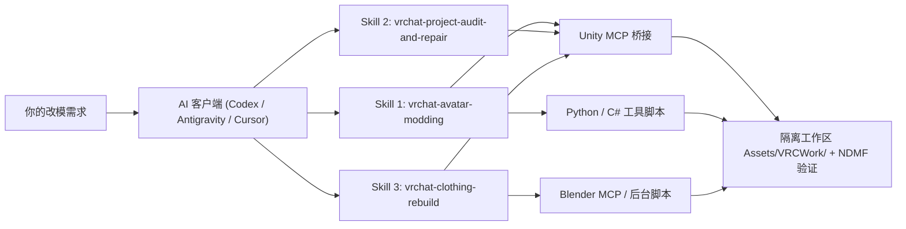

<div align="center">
  
  <h1>VRChat 改模 Skills 与 Unity / Blender MCP 工具包</h1>
</div>

[](https://github.com/asmrawa/vrchat-avatar-modding-skills/actions/workflows/ci.yml)
[](LICENSE)
[](https://creators.vrchat.com/avatars/)

[English](README.md) | **简体中文** | [日本語](README_JA.md)

一套开箱即用的 **Agent Skills + Unity MCP + Blender MCP** 改模工具包，让 **Codex**、**Antigravity**、**Cursor** 等支持 Agent Skills 与 MCP 的 AI 助手，能够安全、非破坏式地完成 Unity 换装、菜单开关、PSD/AI 贴图编辑、性能优化与 Blender 服装贴合重建。

这套工具不只是写给 AI 的口头提示词，而是把 **Unity / Blender 实时控制桥梁（MCP）**、**可复用的 C# / Python 工具脚本** 和 **完整的 VRChat 工程规范** 结合成了一套可复现、可回退的改模工作流。

---

## 它能帮你做什么？

| 模块 | 具体能力 |
| --- | --- |
| **换装、发型与多套衣柜** | 通过 Modular Avatar / NDMF 非破坏式整合衣服与发型；制作多套服装互斥（`Int` 衣柜）；拆分共用蒙皮网格（如把鞋和袜套拆成独立开关）；将帽子/眼镜/发饰做成跨服装共享配件并自动重算蒙皮绑定矩阵；修复换发型后挂机（AFK）消失或错位问题。 |
| **表情菜单、参数与 FX 开关** | 制作独立开关（`Bool`）、多选互斥（`Int`）、条件联动（如戴帽自动收耳、换回其他套装自动恢复）、手持道具互斥、仅翻译菜单显示文案而不破坏参数名，并自动核验每页 8 项与 256-bit 同步参数上限。 |
| **画图与贴图编辑（PSD 优先 + Pillow + GPT Image）** | 匹配的 PSD 适合保留分层。直接改 PNG 时可用 Pillow 做局部换色、透明徽章贴字和边距清理；需要新画虹膜、挑染或刺绣时用 GPT Image 局部编辑，再按遮罩合回。 |
| **道具、受光、微调与性能优化** | 校准手持道具握点、Contact 与约束；统一不同服装材质的受光下限与 `probeAnchor` 探针锚点；审计重复 PhysBone、粒子峰值容量、Mip Streaming、Write Defaults 以及 SDK 本地构建/上传报错。 |
| **Blender 体型服装贴合重建** | 当角色体型改变、衣服单靠缩放或调骨已经贴不上时，在 Blender 后台自动投影重建躯干曲面并输出三视图预览，确认后一键回灌 Unity，完整保留原 FBX 的 UV、材质与蒙皮权重。 |
| **只读项目审计与安全修复** | 默认只读不改文件，帮你查清场景、Prefab 覆盖、GUID/fileID 引用链、菜单/FX 动画绑定以及 NDMF 合并后的真实结果；只有在你明确要求时才在隔离工作区执行最小范围修复与无引用文件清理。 |

---

## 各项功能是怎么实现的？



### 1. Unity 改模是如何做到安全且可回退的？
- **实时操控 Unity（Unity MCP）**：仓库内置 **AnkleBreaker Unity MCP** 插件与 Node 服务端，AI 可以直接发现当前打开的 Unity 实例、读取场景层级、组件、材质槽和动画状态，并按需执行受控 C# 片段和截取编辑器画面，而不是靠猜 YAML 文件盲改。
- **隔离工作版本**：绝不修改原厂导入的预制体、FBX、Controller 和贴图。每次较大修改都在 `Assets/VRCWork/` 下创建独立版本场景与衍生资源副本，只保存本轮修改的资产（`AssetDatabase.SaveAssetIfDirty`），旧版本随时可一键打开回退。
- **三层核验体系**：严格区分 **① 静态序列化文件（YAML/GUID）**、**② Unity 编辑器当前解析状态** 和 **③ NDMF / Modular Avatar / Avatar Optimizer 构建后的最终状态**。所有动画采样和姿态测试都在临时克隆体上进行，确保工作场景的源骨架保持干净。
- **内置 C# 编辑器原语**：[`VrcAvatarIntegration.cs`](skills/vrchat-avatar-modding/scripts/VrcAvatarIntegration.cs) 与 [`VrcMaterialSwap.cs`](skills/vrchat-avatar-modding/scripts/VrcMaterialSwap.cs) 负责安全克隆剪辑与控制器、按属性白名单对齐材质受光、保持世界静止几何不变的骨骼重绑定，以及限定在工作目录内的材质贴图切换。

### 2. 改贴图 / 画图具体是怎么跑通的？
按[贴图操作指南](skills/vrchat-avatar-modding/references/psd-texture-workflow.md)核对底图，再根据交付物选择编辑方式。
1. **先在 Unity 定位真实生效的贴图**：找到实际渲染该部位的 Renderer、子网格、材质槽、Shader 贴图属性（如 `_MainTex`、`_EmissionMap`、叠加层、描边贴图），以及 FX 动画里是否对该槽位做了材质切换。
2. **需要可继续编辑的分层文件时**，优先使用与当前底图吻合的 PSD，在版本副本上保留作者的分组、蒙版、线稿和阴影。
3. **按任务选工具**。直接改 PNG 时从认可的底图开始。色阶或透明文字用 Pillow，新画虹膜、挑染或纹样用 GPT Image；两者的结果也可以放回 PSD 独立图层。
   - **纯换色 / 改色阶**：用 [`vrc_texture_tool.py`](skills/vrchat-avatar-modding/scripts/vrc_texture_tool.py) 的 `recolor`，在灰度遮罩内按原图明度映射新的暗部/中间调/高光，100% 保留原有线条与轮廓。
   - **徽章 / 胸牌加透明文字或图标**：用 `vrc_texture_tool.py composite --decal`，将原尺寸透明 RGBA 图层乘以区域遮罩叠加到底图上，不产生白底方块。
   - **重绘复杂图案（新虹膜/瞳孔、发丝挑染、服装刺绣）**：用 [`vrc_gpt_texture_edit.py`](skills/vrchat-avatar-modding/scripts/vrc_gpt_texture_edit.py)（也支持宿主自带生图工具或纯 Prompt 手动发给 ChatGPT）配合双遮罩（API 引导遮罩 + 像素级保护遮罩）基于原图局部生成；出图后可作为独立蒙版图层贴回 PSD，或经 `clean-bg` 去底噪后用 `composite` 严格锁死遮罩外像素与原图 Alpha 合回原 PNG。
4. **自动化校验与 Unity 上身验收**：运行 `vrc_texture_tool.py compare` 校验分辨率、保护区零改动（`outside_mask=0`）、透明度零变化（`alpha_changed=0`）、可见变化与 PNG ICC/sRGB 色彩标签，再通过 `VrcMaterialSwap.cs` 绑定到工作材质，用角色挂载的 Animator 实测所有状态切换与明暗光照表现。

### 3. Blender 贴身服装重建是怎么实现的？
针对体型大幅改动后穿模严重的衣服（[`vrchat-clothing-rebuild`](skills/vrchat-clothing-rebuild/SKILL.md)）：
1. [`fit_clothing.py`](skills/vrchat-clothing-rebuild/scripts/fit_clothing.py) 在 Blender 后台模式运行，将服装主壳体按可调间隙射线投影到目标素体表面（领口/袖口/腰部平滑过渡），用 KD-Tree 同步带动纽扣、皮带等分离饰件，自动渲染正面、侧面、四分之三正交预览图，同时严格保留原顶点顺序、UV、材质槽和顶点组。
2. 你确认预览图无误后，[`install_unity.py`](skills/vrchat-clothing-rebuild/scripts/install_unity.py) 自动备份工作场景并投递一次性 Unity C# 导入脚本，自动匹配顶点（含 X 轴镜像检测）、迁移原 FBX 的 UV 和蒙皮权重生成新的工作网格资产并保存。
3. 附带 [`blender_mcp_headless.py`](skills/vrchat-clothing-rebuild/scripts/blender_mcp_headless.py)，支持在不弹 Blender 界面的后台模式直接启动 Blender MCP。

### 4. 账号与上传安全边界
- 本地构建、预览与线上上传完全分离，未获你明确要求绝不触发 SDK 上传或修改 Blueprint ID。
- VRChat 账号登录、密码、二步验证（2FA）、人机校验与版权确认**一律交由你在 Unity 可见的 SDK 面板手动完成**，脚本绝不读取、记录或代输任何凭据。

---

## 使用前需要准备什么？

| 组件 | 是否必需 | 用途说明 |
| --- | --- | --- |
| **AI 客户端**（Codex / Antigravity / Cursor 等） | 必需 | 加载 3 个改模 Skills 并挂载 MCP 服务。 |
| **Unity Editor + VRChat SDK3 (Avatars)** | Unity 工程操作需要 | 与工程 `ProjectSettings/ProjectVersion.txt` 匹配的 Unity 版本；推荐搭配 Modular Avatar、NDMF、lilToon / Poiyomi、Gesture Manager、Avatar Optimizer。 |
| **Node.js >= 18** | 用 Unity MCP 必需 | 运行内置的 `unity-mcp/unity-mcp-server` 桥接服务（已在 Node.js 24 验证）。 |
| **Python >= 3.10** | 用 CLI 工具必需 | 运行离线审计、日志摘要、贴图处理、服装脚本与 `doctor.py`。 |
| **Pillow（`pip install pillow`）** | 使用 Pillow 工具时需要 | `vrc_texture_tool.py` 依赖它进行遮罩换色、透明合成、去底噪与像素/ICC 校验。 |
| **Photoshop / PSD 编辑器（或 `psd-tools`）** | 改 PSD 时推荐 | 用于直接编辑保留分层的 `.psd` 源文件并导出 PNG。 |
| **OpenAI 兼容 Images API Key** | 选配（仅 API 直出） | 仅在使用 `vrc_gpt_texture_edit.py` 直连 API 时通过环境变量提供；用宿主自带生图或纯 Prompt 模式不需要。 |
| **Blender + `uv`（`uvx`）** | 选配（改网格/衣服） | Blender 可直接运行服装重建脚本；使用随包提供的 MCP 服务端才需要 uvx。 |

可以随时在仓库根目录运行一键环境体检，看看本机缺什么以及对应的安装命令：

```powershell
python -X utf8 scripts/doctor.py
```

---

## 包含的 3 个 Skills 与目录结构

| Skill | 什么时候用 | 入口文件 |
| --- | --- | --- |
| **`vrchat-avatar-modding`** | 主力改模：换装、衣柜、菜单/FX 开关、道具、PSD/AI 贴图、受光与贴合、性能优化、SDK 打包排错 | [`skills/vrchat-avatar-modding/SKILL.md`](skills/vrchat-avatar-modding/SKILL.md) |
| **`vrchat-project-audit-and-repair`** | 只读体检与排错（静态 YAML/GUID、Unity MCP、离线 `-batchmode`、NDMF 构建态）+ 明确授权下的最小安全修复与清理 | [`skills/vrchat-project-audit-and-repair/SKILL.md`](skills/vrchat-project-audit-and-repair/SKILL.md) |
| **`vrchat-clothing-rebuild`** | Blender 躯干贴合重塑、三视图正交预览与 Unity 保留蒙皮一键回灌 | [`skills/vrchat-clothing-rebuild/SKILL.md`](skills/vrchat-clothing-rebuild/SKILL.md) |

```text
vrchat-avatar-modding-skills/
├── skills/
│   ├── vrchat-avatar-modding/            # 主力改模流程 + 10 篇专题手册 + 7 个 C#/Python 脚本
│   ├── vrchat-project-audit-and-repair/  # 三层只读审计 + 症状分流 + 安全修复校验
│   └── vrchat-clothing-rebuild/          # Blender 重建脚本 + Unity 回灌器 + 无头 MCP 启动器
├── unity-mcp/                            # 内置 AnkleBreaker Unity MCP 插件 (2.32.0) 与服务端 (2.30.0)
├── blender-mcp/                          # 内置 MCP for Blender (2.3.1 wheel 与插件脚本)
├── assets/                               # 项目图标
├── config/                               # MCP 配置示例（Codex TOML、通用 JSON）
├── templates/                            # 通用跨会话改模交接模板（已脱敏）
├── scripts/                              # 环境体检 doctor.py、QA 校验 validate_toolkit.py、打包脚本
├── tests/                                # 20 项 Python 工具自动化单元测试
├── install.ps1 / install.sh              # Windows / macOS / Linux 一键安装脚本
└── THIRD_PARTY_NOTICES.md                # 完整的第三方开源归属与许可声明
```

> 注：所有 `SKILL.md` 与 `references/` 使用精炼英文编写，既省 Token 又兼容各主流模型；你依然可以直接用简体中文、日文或英文向 AI 下达指令。

---

## 快速安装与连接

先将本仓库克隆到固定目录（例如 `C:/Tools/vrchat-avatar-modding-skills`），或从 [GitHub Releases](https://github.com/asmrawa/vrchat-avatar-modding-skills/releases) 直接下载包含全部 Skills 与安装脚本的整合包 `vrchat-avatar-modding-skills.zip`。以下命令均在仓库根目录执行。

### 第 1 步：安装 Skills

**Windows（PowerShell）：**
```powershell
# 可选客户端：codex | antigravity | cursor | all
.\install.ps1 -Client codex

# 可选：顺带安装 Unity MCP 的 Node 依赖和 Blender 插件
.\install.ps1 -Client all -InstallUnityMcpDeps -InstallBlenderAddon
```

**macOS / Linux：**
```bash
chmod +x install.sh
./install.sh codex   # 可选：antigravity | cursor | all
```

### 第 2 步：连接 Unity MCP

1. 用工程要求的对应 Unity 版本打开你的 VRChat 工程。
2. 在 Unity 中打开 `Window → Package Manager → + → Add package from disk...`，选择 [`unity-mcp/unity-mcp-plugin/package.json`](unity-mcp/unity-mcp-plugin/package.json)。
3. 编译完成后打开 `Window → AB Unity MCP`，确认显示 `Server Running`（默认端口 `7890–7899`）。
4. 安装锁定版本的 Node.js 依赖：
   ```powershell
   $toolkit = (Get-Location).Path
   $unityDir = Join-Path $toolkit 'unity-mcp/unity-mcp-server'
   $nodeExe = (Get-Command node.exe -ErrorAction Stop).Source
   $unityEntry = Join-Path $unityDir 'src/index.js'
   Push-Location -LiteralPath $unityDir
   try { npm.cmd ci --omit=dev --ignore-scripts } finally { Pop-Location }
   ```
5. 在你的 AI 客户端中注册 Unity MCP：
   - **Codex CLI**：`codex mcp add unity_mcp -- "$nodeExe" "$unityEntry"`（或合并 [`config/codex.config.example.toml`](config/codex.config.example.toml)）
   - **Antigravity / Cursor / 通用 JSON 客户端**：合并 [`config/antigravity_mcp.example.json`](config/antigravity_mcp.example.json) 中的 `unity-mcp` 段落并替换本机路径。
6. 重启客户端，让 AI 调用 `unity_list_instances` 确认已连上目标工程。

### 第 3 步：连接 Blender MCP（可选）

1. 安装 **Blender** 与 **[uv](https://docs.astral.sh/uv/getting-started/installation/)**。
2. 安装随包提供的 Blender 插件：
   ```powershell
   $toolkit = (Get-Location).Path
   $uvxExe = (Get-Command uvx.exe -ErrorAction Stop).Source
   $wheel = Join-Path $toolkit 'blender-mcp/mcp_for_blender-2.3.1-py3-none-any.whl'
   & $uvxExe --from $wheel mcp-for-blender install-addon
   ```
   *（也可在 Blender `编辑 → 偏好设置 → 插件 → Install from Disk` 中直接选择 [`blender-mcp/mcp_for_blender_addon.py`](blender-mcp/mcp_for_blender_addon.py)。）*
3. 在插件列表勾选启用 `MCP for Blender`，在 3D 视图按 `N` 打开侧栏点击 `Start MCP Server`（或用 [`blender_mcp_headless.py`](skills/vrchat-clothing-rebuild/scripts/blender_mcp_headless.py) 无界面后台启动）。
4. 在客户端注册 Blender MCP：
   - **Codex CLI**：`codex mcp add blender --env BLENDER_MCP_SAFE_MODE=1 --env DISABLE_TELEMETRY=true -- "$uvxExe" --from "$wheel" mcp-for-blender`
   - **Antigravity / Cursor / 通用 JSON 客户端**：参考 [`config/antigravity_mcp.example.json`](config/antigravity_mcp.example.json) 合并 `blender` 段落。

---

## 日常使用指令示例

**1. 首次接手 / 只读体检（推荐先跑一次）：**
> 使用 `vrchat-project-audit-and-repair`。先列出 Unity 实例，核对当前工程、活动场景和角色根对象，再检查现有 Expression Menu、同步参数占用和 FX Controller。本轮仅只读检查，不要修改或保存任何文件。

**2. 换装并接入衣柜菜单：**
> 使用 `vrchat-avatar-modding`。先在 `Assets/VRCWork/` 下另存独立版本工作场景，用 Modular Avatar 整合刚导入的服装预制体并保留原衣开关，验证 NDMF 合并后的骨骼绑定与 256-bit 参数预算，最后汇报改动路径与已验证范围。

**3. 修改眼睛 / 头发 / 衣服贴图：**
> 使用 `vrchat-avatar-modding`。先查清实际显示的材质和底图。需要分层交付时保留可编辑 PSD。这次直接改 PNG，请验证遮罩外像素、Alpha 和色彩信息，再用工作材质给我看近景。

**4. 在 Blender 重建贴身服装：**
> 使用 `vrchat-clothing-rebuild`。在 Blender 检查角色素体和服装网格岛，配置躯干贴合重建并输出三视图预览，等我确认预览图无误后再导回 Unity 工作场景。

> **长期跨多轮对话改模？** 建议把 [`templates/AVATAR_HANDOFF_TEMPLATE.md`](templates/AVATAR_HANDOFF_TEMPLATE.md) 复制到你的私人目录，记录每个版本的场景路径、衣柜参数表和回退基线，新开对话直接发给 AI 就能无缝接力。

---

## 开发者校验与测试

```bash
python -X utf8 scripts/doctor.py
python -X utf8 scripts/validate_toolkit.py
python -X utf8 -m unittest discover -s tests -v
python -X utf8 scripts/package_skills.py
```

---

## 开源许可与第三方声明

- 本仓库原创 Skills、脚本、配置模板与文档采用 **MIT License**（见 [`LICENSE`](LICENSE)）。
- `skills/vrchat-avatar-modding/` 基于 [felixchaos/vrchat-avatar-modding-skill](https://github.com/felixchaos/vrchat-avatar-modding-skill)（**MIT License**）深度扩展。
- `blender-mcp/` 随包提供自 Siddharth Ahuja 的 [mcp-for-blender 2.3.1](https://pypi.org/project/mcp-for-blender/2.3.1/)（**MIT License**）。
- `unity-mcp/`：**Powered by AnkleBreaker MCP**（[unity-mcp-plugin](https://github.com/AnkleBreaker-Studio/unity-mcp-plugin) `2.32.0` · [unity-mcp-server](https://github.com/AnkleBreaker-Studio/unity-mcp-server) `2.30.0`），遵循 **AnkleBreaker Open License v1.0**（允许免费分发与集成，禁止商业转售）。完整声明见 [`THIRD_PARTY_NOTICES.md`](THIRD_PARTY_NOTICES.md)。


> **提示**：请使用你本人合法获取的角色素体、服装、着色器及 VRChat SDK 资产；提交或分享前请勿包含商业模型资产、Blueprint ID 或个人账号信息。
