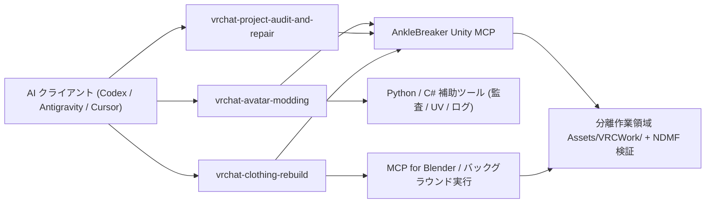

# VRChat アバター改変 Skills & Unity / Blender MCP ツールキット

[](https://github.com/asmrawa/vrchat-avatar-modding-skills/actions/workflows/ci.yml)
[](LICENSE)
[](https://creators.vrchat.com/avatars/)

[English](README.md) | [简体中文](README_CN.md) | **日本語**

VRChat アバター改変の実戦ノウハウを体系化した **Agent Skills** + **Unity MCP** + **Blender MCP** ツールキットです。Unity での着せ替え・ギミック導入・Expression Menu / FX 設定・マテリアル調整・軽量化から、Blender での体型に合わせた衣装リビルドまでを、安全かつ非破壊で自動化・支援します。

**Codex**、**Antigravity**、**Cursor** など、Agent Skills 仕様および MCP に対応する各種 AI クライアントで利用できます。

---

## このツールキットの特徴

一般的な AI アシスタントにそのまま Unity プロジェクトを触らせると、配布プレハブを直接上書きしてしまったり、Unity YAML を誤解釈したり、アニメーション確認時に基準ポーズ（レストポーズ）を汚して衣装が浮いたり、256-bit の同期パラメータ上限を超えてしまう事故が起こりがちです。

本ツールキットでは、実戦のアバター改変で培った安全設計を **3 つの役割明確な Skills** に集約しています。

- **非破壊・バージョン分離を徹底**：BOOTH などで購入した元アセット（FBX・Prefab・Controller）は一切編集せず、`Assets/VRCWork/` 配下のバージョン別作業シーンで作業し、`AssetDatabase.SaveAssetIfDirty` で安全に保存・ロールバック可能にします。
- **3 層検証モデル**：**静的ファイル（YAML / GUID）**、**Unity エディタ解析状態（MCP / `-batchmode`）**、**NDMF / Modular Avatar / AAO ビルド後状態** を明確に区別して検証・報告します。
- **よくある改変トラブルの対策手順を内蔵**：レストポーズ汚染による衣装浮き、NDMF ビルド再入によるピンク球事故、AFK 時の移植ヘア消失、`probeAnchor` や最低輝度差による暗所発光見え、AAO による BlendShape リマップ、PhysBone 重複監査、共通メッシュ（靴・靴下など）の分離、UV 透過デカール・文字入れ、256-bit パラメータ監査に対応。
- **アカウント安全境界**：VRChat SDK のログイン・パスワード・2FA・CAPTCHA は必ず Unity の公式 SDK パネル上でユーザー本人が操作する設計とし、認証情報をスクリプトやログに扱いません。

---

## ワークフロー構成



## 収録 Skills（全 3 種）

| Skill | 役割 | 主な対応範囲 |
| --- | --- | --- |
| [`vrchat-avatar-modding`](skills/vrchat-avatar-modding/SKILL.md) | **アバター改変メインワークフロー** | 着せ替え・排他ワードローブ、手持ちギミック・Contact、Expression Menu & FX トグル、AFK 髪消失修正、UV 改色・デカール、フィット・ライティング統一、身長警告・軽量化最適化、SDK ビルド/アップロード切り分け、C#/Python 補助スクリプト 7 種 |
| [`vrchat-project-audit-and-repair`](skills/vrchat-project-audit-and-repair/SKILL.md) | **読み取り専用監査 ＆ 明示許可時の安全修復** | 3 層調査（静的 GUID/fileID、Unity MCP または 2 パス `-batchmode`、NDMF ビルド出力）、症状別トリアージ、参照ゼロを証明した上での安全なクリーンアップ |
| [`vrchat-clothing-rebuild`](skills/vrchat-clothing-rebuild/SKILL.md) | **Blender 衣装シルエット再構築** | 体型変更に合わせた Blender バックグラウンド投影リビルド（UV・マテリアル・ウェイト保持）、3 方向平行投影プレビュー、Unity ワンショット反映、ヘッドレス Blender MCP 起動スクリプト |

> 注：各 `SKILL.md` および `references/` はトークン効率とクライアント横断の互換性を高めるため簡潔な英語で記述していますが、AI への指示・会話は日本語のまま問題なく利用できます。

---

## ディレクトリ構成

```text
vrchat-avatar-modding-skills/
├── skills/
│   ├── vrchat-avatar-modding/            # 改変メインフロー + リファレンス 11 本 + C#/Python スクリプト 7 本
│   ├── vrchat-project-audit-and-repair/  # 読み取り専用監査 + 症状診断 + 安全修復チェックリスト
│   └── vrchat-clothing-rebuild/          # Blender リビルドパイプライン + Unity 反映器 + ヘッドレス起動器
├── unity-mcp/                            # 同梱 AnkleBreaker Unity MCP プラグイン (2.32.0) ＆ サーバー (2.30.0)
├── blender-mcp/                          # 同梱 MCP for Blender (2.3.1 wheel ＆ アドオン)
├── config/                               # MCP 設定サンプル（Codex / Antigravity / Cursor）
├── templates/                            # 複数セッション引き継ぎテンプレート（汎用版）
├── scripts/                              # 環境診断 doctor・自動品質検証・ZIP 生成スクリプト
├── tests/                                # 同梱 Python CLI ツール用ユニットテスト
├── install.ps1 / install.sh              # Windows / macOS / Linux ワンクリック導入スクリプト
└── THIRD_PARTY_NOTICES.md                # サードパーティ権利表記・ライセンス一覧
```

---

## クイックスタート

本リポジトリを固定ディレクトリ（例：`C:/Tools/vrchat-avatar-modding-skills`）にクローンまたは展開し、リポジトリルートから以下のコマンドを実行します。

### 1. Skills をインストール

**Windows（PowerShell）：**

```powershell
# Codex へ導入（antigravity / cursor / all も指定可能）
.\install.ps1 -Client codex

# オプション：Unity MCP の Node 依存パッケージと Blender アドオンも一括導入
.\install.ps1 -Client all -InstallUnityMcpDeps -InstallBlenderAddon
```

**macOS / Linux：**

```bash
chmod +x install.sh
./install.sh codex   # antigravity | cursor | all
```

導入後、クライアントを再起動するか新しいセッションを開始してください。

**環境セルフチェック（不足ツールを一覧確認）：**

```powershell
python -X utf8 scripts/doctor.py
```

**長期改変の引き継ぎテンプレート**：[`templates/AVATAR_HANDOFF_TEMPLATE.md`](templates/AVATAR_HANDOFF_TEMPLATE.md) をご自身のプライベート作業フォルダへコピーすると、バージョン履歴・着せ替えパラメータ・ロールバック先を新セッションへ正確に引き継げます。

---

### 2. Unity MCP を接続

1. プロジェクトの `ProjectSettings/ProjectVersion.txt` に記載された正確な Unity バージョンでプロジェクトを開きます。
2. Unity 上部メニュー `Window -> Package Manager -> + -> Add package from disk...` から [`unity-mcp/unity-mcp-plugin/package.json`](unity-mcp/unity-mcp-plugin/package.json) を読み込みます。
3. コンパイル完了後、`Window -> AB Unity MCP` を開き、`Server Running`（既定ポート範囲 `7890–7899`）になっていることを確認します。
4. ロック済みの Node.js 依存パッケージをインストールします（Node.js 18 以上が必要、Node.js 24 で検証済み）：

```powershell
$toolkit = (Get-Location).Path
$unityDir = Join-Path $toolkit 'unity-mcp/unity-mcp-server'
$nodeExe = (Get-Command node.exe -ErrorAction Stop).Source
$unityEntry = Join-Path $unityDir 'src/index.js'
Push-Location -LiteralPath $unityDir
try { npm.cmd ci --omit=dev --ignore-scripts } finally { Pop-Location }
```

5. 利用中の AI クライアントに Unity MCP を登録します：
   - **Codex CLI**：`codex mcp add unity_mcp -- "$nodeExe" "$unityEntry"`（または [`config/codex.config.example.toml`](config/codex.config.example.toml) をマージ）。
   - **Antigravity / Cursor / 汎用 JSON クライアント**：[`config/antigravity_mcp.example.json`](config/antigravity_mcp.example.json) の `unity-mcp` 項目をローカルパスに書き換えてマージします。
6. クライアントを再起動し、`unity_list_instances` でプロジェクトとシーンを確認後、`unity_select_instance` で対象インスタンスを選択させます。

---

### 3. Blender MCP を接続（メッシュ編集・衣装リビルド用・任意）

1. **Blender** と **[uv](https://docs.astral.sh/uv/getting-started/installation/)**（Python 3.10 以上）をインストールします。
2. 同梱の wheel から対応する Blender アドオンをインストールします：

```powershell
$toolkit = (Get-Location).Path
$uvxExe = (Get-Command uvx.exe -ErrorAction Stop).Source
$wheel = Join-Path $toolkit 'blender-mcp/mcp_for_blender-2.3.1-py3-none-any.whl'
& $uvxExe --from $wheel mcp-for-blender install-addon
```

   *（または Blender の `編集 -> プリファレンス -> アドオン -> ディスクからインストール` で [`blender-mcp/mcp_for_blender_addon.py`](blender-mcp/mcp_for_blender_addon.py) を直接導入できます。）*
3. Blender のアドオン一覧で `MCP for Blender` を有効にし、3D ビューポートで `N` キーを押してサイドバーから `Start MCP Server` をクリックします（GUI なしで起動したい場合は [`skills/vrchat-clothing-rebuild/scripts/blender_mcp_headless.py`](skills/vrchat-clothing-rebuild/scripts/blender_mcp_headless.py) を利用できます）。
4. クライアントへ登録します：
   - **Codex CLI**：`codex mcp add blender --env BLENDER_MCP_SAFE_MODE=1 --env DISABLE_TELEMETRY=true -- "$uvxExe" --from "$wheel" mcp-for-blender`（または [`config/codex.config.example.toml`](config/codex.config.example.toml) をマージ）。
   - **Antigravity / Cursor / 汎用 JSON クライアント**：[`config/antigravity_mcp.example.json`](config/antigravity_mcp.example.json) を参照して `blender` 項目をマージします。

---

## AI を使った UV テクスチャ編集

虹彩、髪のハイライト、刺繍の描き直しには GPT Image の部分編集を使います。階調変換、名札への透過文字の合成、UV アイランド間の余白の修復には Pillow を使います。API、ホスト内蔵の画像編集、プロンプトのみの各手順を収録しています。元画像のマスクで合成し、アルファ値を検証してから Unity で表示と着せ替えを確認します。[UV テクスチャ編集ガイド](skills/vrchat-avatar-modding/references/ai-texture-generation.md)

名札の透過文字には元画像と同じサイズの RGBA レイヤーと `composite --decal` を使います。`compare --require-visible-change` で透明画素だけが変わった候補を検出できます。ガイドには目、髪、髪飾り、衣装をエディターで確認した事例もあります。

## 最初のプロンプト例

**読み取り専用チェック（初回におすすめ）：**

> `vrchat-project-audit-and-repair` を使ってください。まず Unity インスタンスを一覧表示し、対象プロジェクト・アクティブシーン・アバタールートを確認した上で、現在の Expression Menu、同期パラメータ消費ビット数、FX Controller の構成を調べてください。このターンは読み取り専用とし、ファイルの変更や保存は行わないでください。

**衣装の着せ替えとメニュー統合：**

> `vrchat-avatar-modding` を使ってください。`Assets/VRCWork/` に新しいバージョン別作業シーンを作成し、インポート済みの衣装プレハブを Modular Avatar で統合してください。元の衣装トグルを維持したまま、NDMF ビルド後のボーン結合と 256-bit パラメータ上限を検証し、検証できた範囲を報告してください。

**Blender での衣装リビルド：**

> `vrchat-clothing-rebuild` を使ってください。Blender で素体と衣装メッシュのアイランドを確認し、3 方向プレビュー付きでリビルド設定を作成してください。プレビュー画像を私が確認してから Unity 側の取り込みを実行してください。

---

## 検証

```bash
# Frontmatter・Markdown リンク・プライバシー検査・Python 構文チェック
python scripts/validate_toolkit.py

# 同梱 Python CLI ツールのユニットテストを実行
python -m unittest discover -s tests -v

# dist/ に各スキルの ZIP を生成
python -X utf8 scripts/package_skills.py
```

---

## ライセンスと権利表記

- 本リポジトリのオリジナル Skills・スクリプト・設定テンプレート・ドキュメント：**MIT License**（[`LICENSE`](LICENSE)）
- `skills/vrchat-avatar-modding/`：[felixchaos/vrchat-avatar-modding-skill](https://github.com/felixchaos/vrchat-avatar-modding-skill)（**MIT License**）をベースに大幅拡張
- `blender-mcp/`：Siddharth Ahuja 氏による [mcp-for-blender 2.3.1](https://pypi.org/project/mcp-for-blender/2.3.1/)（**MIT License**）を同梱
- `unity-mcp/`：**Powered by AnkleBreaker MCP**（[unity-mcp-plugin](https://github.com/AnkleBreaker-Studio/unity-mcp-plugin) `2.32.0` ・ [unity-mcp-server](https://github.com/AnkleBreaker-Studio/unity-mcp-server) `2.30.0`）。**AnkleBreaker Open License v1.0**（無料配布・統合は許可、商用転売は禁止）が適用されます。詳細は [`THIRD_PARTY_NOTICES.md`](THIRD_PARTY_NOTICES.md) をご確認ください。


> **ご注意**：アバター素体・衣装・シェーダー・VRChat SDK は必ずご自身が正当に入手したものをご利用ください。商用アセット・Blueprint ID・認証情報は絶対にリポジトリへ含めないでください。
