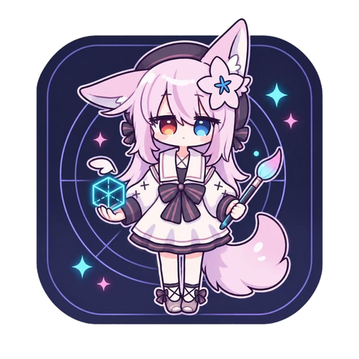
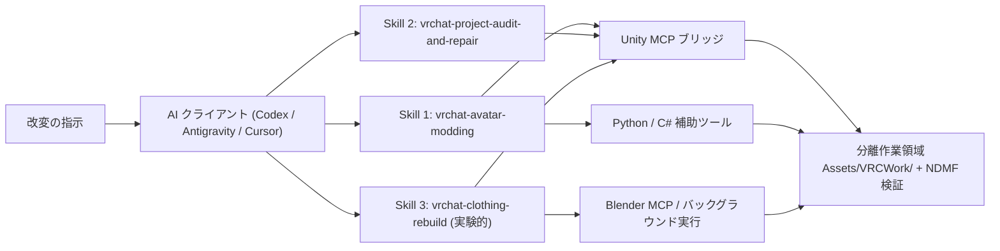

<div align="center">
  
  <h1>VRChat アバター改変 Skills & Unity / Blender MCP ツールキット</h1>
</div>

[](https://github.com/asmrawa/vrchat-avatar-modding-skills/actions/workflows/ci.yml)
[](LICENSE)
[](https://creators.vrchat.com/avatars/)

[English](README.md) | [简体中文](README_CN.md) | **日本語**

**Codex**・**Antigravity**・**Cursor** などの Agent Skills / MCP 対応 AI アシスタントを使って、Unity での着せ替え・ギミック導入・PSD/AI テクスチャ改変・最適化から Blender での衣装リビルドまでを、安全かつ非破壊で進めるためのオールインワンツールキットです。

単なるプロンプト集ではなく、**Unity / Blender を直接操作する MCP ブリッジ**、**検証済みの C# / Python 補助スクリプト**、**VRChat 改変の標準手順書（Skills）** を一体化したワークフローを提供します。

---

## このツールキットでできること

| 分野 | 主な機能 |
| --- | --- |
| **着せ替え・髪型・ワードローブ構築** | Modular Avatar / NDMF を使った非破壊の衣装・髪型導入、`Int` パラメータによる排他着せ替え、共通メッシュの分離（靴と靴下を別トグル化など）、衣装を跨ぐ共通アクセサリのボーン・バインドポーズ再計算、AFK 時の移植ヘア表示修正。 |
| **Expression Menu・パラメータ・FX 制御** | 独立トグル（`Bool`）、排他選択（`Int`）、連動制御（帽子着用時に耳を隠し脱ぐと復帰するなど）、手持ちアイテム排他、パラメータ名を壊さないメニュー翻訳、1 ページ 8 項目・同期パラメータ 256-bit 上限の自動監査。 |
| **テクスチャ・PSD 改変（PSD 優先 + Pillow + GPT Image）** | レイヤー編集には位置が一致する PSD を使用。PNG を直接編集する場合は Pillow で階調や透過文字を処理し、描き起こしには GPT Image とマスク合成を使用します。 |
| **ギミック・ライティング・軽量化** | 手持ちプロップ・Contact・Constraint の姿勢合わせ、`probeAnchor` やマテリアル受光の統一、重複 PhysBone・パーティクル上限・Mip Streaming・Write Defaults・SDK ビルド/アップロードエラーの切り分け。 |
| **Blender 補助操作 ＆ 衣装リビルド（実験的）** | メッシュ検査・構造確認・補助編集用に Blender MCP を搭載。実験的機能として、UV・ウェイトを保持して胴体フィットを再構築する `vrchat-clothing-rebuild`（明示指定時のみ）を同梱していますが、貫通・動的ポーズの目視確認が必要です。 |
| **読み取り専用監査 ＆ 安全修復** | ファイルを一切変更せずにシーン・Prefab オーバーライド・GUID/fileID 参照・Animator カーブ・NDMF ビルド出力を調査し、明示指示時のみ作業領域内で最小限の修復と参照ゼロ資産のクリーンアップを実行。 |

---

## 各機能の仕組み（アーキテクチャ）



### 1. 非破壊・ロールバック可能な Unity 自動化
- **Unity MCP によるライブ操作**：同梱の **AnkleBreaker Unity MCP** により、AI が起動中の Unity エディタへ直接接続して `VRCAvatarDescriptor`、Modular Avatar コンポーネント、マテリアル、Animator 構成を正確に読み取り、必要に応じて C# スニペット実行やキャプチャ確認を行います。
- **完全バージョン分離**：BOOTH 等で購入した元アセットは変更しません。すべての編集は `Assets/VRCWork/` 配下のバージョン別シーン・コピーアセットで行い、`AssetDatabase.SaveAssetIfDirty` で対象資産のみ保存するためいつでも前の版へ戻せます。
- **3 層検証**：**(1) 静的 YAML/GUID**、**(2) Unity エディタ解析状態**、**(3) NDMF / Modular Avatar / AAO ビルド後状態** を分けて検証します。アニメーションや姿勢確認は一時クローン上で行い、作業シーンのレストポーズを汚しません。
- **同梱 C# ユーティリティ**：[`VrcAvatarIntegration.cs`](skills/vrchat-avatar-modding/scripts/VrcAvatarIntegration.cs) と [`VrcMaterialSwap.cs`](skills/vrchat-avatar-modding/scripts/VrcMaterialSwap.cs) により、クリップ/コントローラー複製、ライティング項目コピー、静止形状を保つバインドポーズ再計算、作業マテリアル限定のテクスチャ差し替えを安全に実行します。

### 2. テクスチャ・PSD 改変の仕組み（PSD 優先パイプライン）
[UV 編集ガイド](skills/vrchat-avatar-modding/references/psd-texture-workflow.md)に従い、Unity で使用中の画像に対応する編集可能な元データを確認します。
1. **Unity 上で実際に使われているテクスチャを特定**：対象部位を描画している Renderer、サブメッシュ、マテリアルスロット、シェーダープロパティ（`_MainTex`、`_EmissionMap`、重ね塗り・輪郭線テクスチャ）および FX のマテリアル切り替えを追跡します。
2. **対応する PSD を優先**します。納品が PNG のみでも、PSD の作業用コピーを編集し、既存のグループ、マスク、線画、陰影を保持します。
3. **目的に応じた編集**。レイヤーを保った編集ができない場合や、PNG の直接編集を指定された場合は、承認済みの PNG を使います。色調変換や透過文字には Pillow、描き起こしには GPT Image を使い、結果を PSD のレイヤーにも配置できます。
   - **色変え・階調マップ**：[`vrc_texture_tool.py`](skills/vrchat-avatar-modding/scripts/vrc_texture_tool.py) の `recolor` で、グレースケールマスク内の明度を新しい影・中間・ハイライトへ変換します。
   - **透過文字・名札デカール**：`vrc_texture_tool.py composite --decal` で元サイズ RGBA レイヤーをアイランドマスク越しに合成します。
   - **新規描き起こし（虹彩・ハイライト・刺繍など）**：[`vrc_gpt_texture_edit.py`](skills/vrchat-avatar-modding/scripts/vrc_gpt_texture_edit.py)（ホスト内蔵画像ツールやプロンプトのみでの ChatGPT 利用にも対応）で 2 種類のマスク（API 誘導マスク＋厳密保護マスク）を使い元図から生成し、PSD の新規マスク付きレイヤーへ貼るか、`clean-bg` 後に `composite` で元 PNG へ無劣化合成します。
4. **ファイル・Unity の状態・見た目を確認**します。`vrc_texture_tool.py compare` で画像の寸法、保護範囲の画素、アルファ、色メタデータを確認します。アバターの Animator で対象の状態を切り替え、保存後の参照を確認します。同じ条件でレンダリング結果を比較し、画像を確認できない場合は目視確認を保留と記録します。

### 3. Blender MCP と衣装リビルド（実験的機能）
本ツールキットでは、**Blender MCP（モデル検査・補助編集ブリッジ）** と、実験的な**自動衣装リビルド手順（[`vrchat-clothing-rebuild`](skills/vrchat-clothing-rebuild/SKILL.md)）** を切り分けて扱います：

- **現在の実装状況**：
  1. **Blender MCP**：Blender 内のオブジェクト確認、メッシュアイランド解析、部分的な補助編集を行うオプション拡張として利用できます（[`blender_mcp_headless.py`](skills/vrchat-clothing-rebuild/scripts/blender_mcp_headless.py) によるヘッドレス起動にも対応）。
  2. **実験的リビルドフロー**：[`fit_clothing.py`](skills/vrchat-clothing-rebuild/scripts/fit_clothing.py) がレイキャスト投影と KD-Tree で胴体・装飾を調整し、3 方向プレビューを生成します。[`install_unity.py`](skills/vrchat-clothing-rebuild/scripts/install_unity.py) により UV・マテリアル・ウェイトを保持したまま Unity へ再取り込みするテストにも成功しています。
- **現在の技術的制約**：
  - **完全な衝突解決は未対応**：主にレイキャスト投影で頂点を調整するため、素体との非交差を完全には保証できません。
  - **動的ポーズでの貫通リスク**：静止状態で問題がなくても、腕上げ・しゃがみ・脚上げ等のモーションで貫通が生じる場合があります。
  - **適用範囲の限定**：特定ローカル座標系（`X` 横、`Y` 上、`+Z` 前）の胴体衣装が対象で、Unity インポーターは単一サブメッシュ（`subMeshCount == 1`）のみ対応しています。
  - **自動修復機構の不足**：出力後に手動での調整・修正が必要になるケースがあります。
  - **技術的取り込み完了 ≠ 見た目の合格**：UV とウェイトが正常に引き継がれても、すべてのアバター・衣装で実戦投入できる見た目を保証するものではありません。
- **利用上の推奨**：Blender MCP は補助ツールとして活用できますが、自動衣装リビルドを通常・本番のデフォルト手順として使うことは推奨しません。普段の改変は **Unity MCP + Modular Avatar + NDMF + 対応済み衣装** を優先し、`vrchat-clothing-rebuild` は**プロジェクトをバックアップした上で実験的検証を明示希望し、結果を人間が目視確認できる場合のみ**使用してください。

### 4. アカウント・アップロード安全設計
- ローカルビルド・プレビュー・オンラインアップロードは明確に分離し、明示的な依頼なしにアップロードや Blueprint ID 変更を行いません。
- VRChat SDK のログイン・パスワード・2FA・CAPTCHA・権利確認は**必ず Unity の公式 SDK パネル上でユーザー本人が操作**します。

---

## 必要な環境・準備するもの

| 項目 | 要否 | 用途 |
| --- | --- | --- |
| **AI クライアント**（Codex / Antigravity / Cursor 等） | 必須 | 3 つの Skills 読み込みと MCP サーバー接続。 |
| **Unity Editor + VRChat SDK3 (Avatars)** | Unity 作業時に必要 | `ProjectSettings/ProjectVersion.txt` 一致バージョン。Modular Avatar / NDMF / lilToon・Poiyomi / Gesture Manager / Avatar Optimizer 推奨。 |
| **Node.js >= 18** | Unity MCP に必須 | 同梱 `unity-mcp/unity-mcp-server` の実行（Node.js 24 で検証済み）。 |
| **Python >= 3.10** | CLI ツールに必須 | オフライン監査・ログ要約・テクスチャツール・衣装スクリプト・`doctor.py` の実行。 |
| **Pillow（`pip install pillow`）** | Pillow ツール使用時のみ | `vrc_texture_tool.py`（`recolor` / `composite` / `clean-bg` / `compare`）に必要。 |
| **Photoshop 等 PSD エディタ（または `psd-tools`）** | PSD 編集時に推奨 | レイヤー保持状態での `.psd` 編集と書き出し。 |
| **OpenAI 互換 Images API キー** | 任意（API 直接生成時） | `vrc_gpt_texture_edit.py` で直接 API を叩く場合のみ環境変数で指定。ホスト画像ツールやプロンプト運用では不要。 |
| **Blender + `uv`（`uvx`）** | 任意（検査 / 実験的リビルド） | モデル検査や実験的リビルドは Blender 単体で実行可能。uvx は同梱 Blender MCP サーバー起動時のみ必要です。 |

リポジトリルートで以下のコマンドを実行すると、不足ツールと導入手順を一覧チェックできます：

```powershell
python -X utf8 scripts/doctor.py
```

---

## 収録 Skills とディレクトリ構成

| Skill | 主な用途 | エントリ |
| --- | --- | --- |
| **`vrchat-avatar-modding`** | 改変全般：着せ替え、ワードローブ、メニュー/FX、ギミック、PSD/AI テクスチャ、ライティング・フィット、軽量化、SDK ビルド切り分け | [`skills/vrchat-avatar-modding/SKILL.md`](skills/vrchat-avatar-modding/SKILL.md) |
| **`vrchat-project-audit-and-repair`** | 読み取り専用 3 層監査（静的 YAML/GUID・Unity MCP・`-batchmode`・NDMF ビルド）＋明示許可時の安全修復・クリーンアップ | [`skills/vrchat-project-audit-and-repair/SKILL.md`](skills/vrchat-project-audit-and-repair/SKILL.md) |
| **`vrchat-clothing-rebuild`** | *（実験的 / 明示指定時のみ）* Blender 衣装シルエット再構築・Unity 再取り込み（通常ワークフローでの既定利用は非推奨） | [`skills/vrchat-clothing-rebuild/SKILL.md`](skills/vrchat-clothing-rebuild/SKILL.md) |

```text
vrchat-avatar-modding-skills/
├── skills/
│   ├── vrchat-avatar-modding/            # 改変メインフロー + リファレンス 10 本 + C#/Python スクリプト 7 本
│   ├── vrchat-project-audit-and-repair/  # 3 層読み取り専用監査 + 症状診断 + 安全修復チェックリスト
│   └── vrchat-clothing-rebuild/          # 実験的 Blender リビルド手順 + Unity 反映器 + ヘッドレス起動器
├── unity-mcp/                            # 同梱 AnkleBreaker Unity MCP プラグイン (2.32.0) ＆ サーバー (2.30.0)
├── blender-mcp/                          # 同梱 MCP for Blender (2.3.1 wheel ＆ アドオン)
├── assets/                               # プロジェクトアイコン
├── config/                               # MCP 設定サンプル（Codex TOML / 汎用 JSON）
├── templates/                            # 複数セッション引き継ぎテンプレート（汎用版）
├── scripts/                              # 環境診断 doctor.py・QA 検証・ZIP パッケージ生成スクリプト
├── tests/                                # Python ツール用ユニットテスト（全 20 件）
├── install.ps1 / install.sh              # Windows / macOS / Linux ワンクリック導入スクリプト
└── THIRD_PARTY_NOTICES.md                # サードパーティ権利表記・ライセンス一覧
```

> 注：`SKILL.md` と `references/` はトークン効率と精度のため簡潔な英語で書かれていますが、普段の指示や会話は日本語のままで問題なく動作します。

---

## クイックスタート

本リポジトリを固定フォルダ（例：`C:/Tools/vrchat-avatar-modding-skills`）へクローンするか、[GitHub Releases](https://github.com/asmrawa/vrchat-avatar-modding-skills/releases) から全スキル同梱の `vrchat-avatar-modding-skills.zip` をダウンロードしてください。以下はリポジトリルートから実行します。

### ステップ 1：Skills をインストール

**Windows（PowerShell）：**
```powershell
# 指定先：codex | antigravity | cursor | all
.\install.ps1 -Client codex

# オプション：Unity MCP の Node 依存と Blender アドオンも一括導入
.\install.ps1 -Client all -InstallUnityMcpDeps -InstallBlenderAddon
```

**macOS / Linux：**
```bash
chmod +x install.sh
./install.sh codex   # antigravity | cursor | all
```

### ステップ 2：Unity MCP を接続

1. プロジェクト指定の Unity バージョンでプロジェクトを開きます。
2. Unity の `Window -> Package Manager -> + -> Add package from disk...` から [`unity-mcp/unity-mcp-plugin/package.json`](unity-mcp/unity-mcp-plugin/package.json) を読み込みます。
3. コンパイル後、`Window -> AB Unity MCP` を開き `Server Running`（既定ポート `7890–7899`）を確認します。
4. ロック済みの Node.js 依存をインストールします：
   ```powershell
   $toolkit = (Get-Location).Path
   $unityDir = Join-Path $toolkit 'unity-mcp/unity-mcp-server'
   $nodeExe = (Get-Command node.exe -ErrorAction Stop).Source
   $unityEntry = Join-Path $unityDir 'src/index.js'
   Push-Location -LiteralPath $unityDir
   try { npm.cmd ci --omit=dev --ignore-scripts } finally { Pop-Location }
   ```
5. AI クライアントに Unity MCP を登録します：
   - **Codex CLI**：`codex mcp add unity_mcp -- "$nodeExe" "$unityEntry"`（または [`config/codex.config.example.toml`](config/codex.config.example.toml) をマージ）
   - **Antigravity / Cursor / 汎用 JSON クライアント**：[`config/antigravity_mcp.example.json`](config/antigravity_mcp.example.json) の `unity-mcp` 項目をローカルパスに書き換えてマージします。
6. クライアントを再起動し、`unity_list_instances` で接続を確認します。

### ステップ 3：Blender MCP を接続（任意）

1. **Blender** と **[uv](https://docs.astral.sh/uv/getting-started/installation/)** をインストールします。
2. 同梱 wheel から Blender アドオンをインストールします：
   ```powershell
   $toolkit = (Get-Location).Path
   $uvxExe = (Get-Command uvx.exe -ErrorAction Stop).Source
   $wheel = Join-Path $toolkit 'blender-mcp/mcp_for_blender-2.3.1-py3-none-any.whl'
   & $uvxExe --from $wheel mcp-for-blender install-addon
   ```
   *（Blender の `プリファレンス -> アドオン -> ディスクからインストール` で [`blender-mcp/mcp_for_blender_addon.py`](blender-mcp/mcp_for_blender_addon.py) を直接入れることもできます。）*
3. `MCP for Blender` を有効化し、3D ビューポートで `N` → サイドバーの `Start MCP Server` を押します（GUI 無しで動かす場合は [`blender_mcp_headless.py`](skills/vrchat-clothing-rebuild/scripts/blender_mcp_headless.py) を使用）。
4. クライアントへ登録します：
   - **Codex CLI**：`codex mcp add blender --env BLENDER_MCP_SAFE_MODE=1 --env DISABLE_TELEMETRY=true -- "$uvxExe" --from "$wheel" mcp-for-blender`
   - **Antigravity / Cursor / 汎用 JSON クライアント**：[`config/antigravity_mcp.example.json`](config/antigravity_mcp.example.json) の `blender` 項目をマージします。

---

## 使い方のプロンプト例

**1. 初回の読み取り専用チェック：**
> `vrchat-project-audit-and-repair` を使ってください。Unity インスタンスを一覧表示し、対象プロジェクト・アクティブシーン・アバタールートを確認した上で、Expression Menu、同期パラメータ消費ビット数、FX Controller を調べてください。このターンは読み取り専用とし、変更・保存はしないでください。

**2. 衣装の着せ替えとメニュー統合：**
> `vrchat-avatar-modding` を使ってください。`Assets/VRCWork/` に新しいバージョン別作業シーンを作成し、インポート済みの衣装プレハブを Modular Avatar で統合してください。元の衣装トグルを維持したまま、NDMF ビルド後のボーン結合と 256-bit 上限を検証して結果を報告してください。

**3. テクスチャ編集：**
> 使用中のマテリアルと元画像を確認してください。今回は PNG を直接編集し、保護範囲の画素、アルファ値、色メタデータを確認して、作業用マテリアルの近接画像を見せてください。

**4. 実験的な Blender 衣装リビルド検証（バックアップ・目視確認前提）：**
> プロジェクトのバックアップ済みです。`vrchat-clothing-rebuild` で実験的な衣装リビルドを試したいので、まず Blender で素体と衣装のアイランドを確認して 3 方向プレビューを作成し、私の目視確認が終わるまで Unity への取り込みは待ってください。

> **長期改変の引き継ぎ**：[`templates/AVATAR_HANDOFF_TEMPLATE.md`](templates/AVATAR_HANDOFF_TEMPLATE.md) をプライベートフォルダにコピーしてバージョン履歴や着せ替えパラメータを控えておくと、新しいセッションでもスムーズに引き継げます。

---

## 検証・テスト

```bash
python -X utf8 scripts/doctor.py
python -X utf8 scripts/validate_toolkit.py
python -X utf8 -m unittest discover -s tests -v
python -X utf8 scripts/package_skills.py
```

---

## ライセンスと権利表記

- 本リポジトリのオリジナル Skills・スクリプト・テンプレート・ドキュメント：**MIT License**（[`LICENSE`](LICENSE)）
- `skills/vrchat-avatar-modding/`：[felixchaos/vrchat-avatar-modding-skill](https://github.com/felixchaos/vrchat-avatar-modding-skill)（**MIT License**）をベースに拡張
- `blender-mcp/`：Siddharth Ahuja 氏による [mcp-for-blender 2.3.1](https://pypi.org/project/mcp-for-blender/2.3.1/)（**MIT License**）を同梱
- `unity-mcp/`：**Powered by AnkleBreaker MCP**（[unity-mcp-plugin](https://github.com/AnkleBreaker-Studio/unity-mcp-plugin) `2.32.0` ・ [unity-mcp-server](https://github.com/AnkleBreaker-Studio/unity-mcp-server) `2.30.0`）。**AnkleBreaker Open License v1.0**（無料配布・統合は許可、商用転売は禁止）が適用されます。詳細は [`THIRD_PARTY_NOTICES.md`](THIRD_PARTY_NOTICES.md) をご確認ください。


> **ご注意**：アバター素体・衣装・シェーダー・VRChat SDK は必ず正当に入手したものをご利用ください。商用アセット・Blueprint ID・認証情報はリポジトリに含めないでください。
